# CFE: An Overview — 2026-11-19

*This is a living document — more sections get added as we go. Today
covers the objective and a first look at what "running at scale" actually
means in practice.*

---

## Slide: What is CFE, and why does it exist?

- The objective of CFE is simple to state and hard to build: a
  **computational fluid dynamics environment that students can implement
  their own numerical methods into**, where those methods aren't just
  demos — they have to actually **work at scale** and produce **meaningful
  large-scale simulation results**.
- That "at scale" part is the whole point. A method that only works on a
  small, serial, toy problem hasn't really been tested — the interesting
  science (and the interesting bugs) shows up once you're running millions
  of cells across real hardware.
- **CFE is built from the ground up to be a reacting-flow solver** — it can
  carry multiple chemical species through the simulation as a first-class
  concern, not a bolted-on afterthought.
- This is a deliberate, unusual choice. Most CFD codes are written for a
  single species (just "the fluid"), and adding real chemistry later
  usually means painful, invasive rework of code that was never designed
  to carry extra state around per cell. CFE's field/storage model is
  designed from day one to scale to many transported species, so that
  rework never has to happen.
- In one sentence: **CFE exists so a student's numerical method doesn't
  have to choose between being correct, being fast, and eventually
  handling real chemistry — it should be able to do all three.**

---

## Slide: What "at scale" actually requires

- Running "at scale" isn't just a bigger computer — it's a specific way of
  splitting up the work so that many pieces of hardware can all contribute
  to one simulation at once.
- The core idea, used by essentially all serious HPC/CFD codes (CFE
  included): take the simulation domain and **dice it up into a grid of
  smaller boxes** (subdomains), hand each box to a different process
  (a **rank**, often its own node or its own GPU), and then, *within* each
  of those boxes, parallelize again across whatever hardware that one rank
  actually has — a handful of CPU threads, or a GPU's thousands of
  lightweight threads.
- That's **two separate levels of parallelism**, stacked on top of each
  other, and it's worth seeing as a picture rather than just a description:

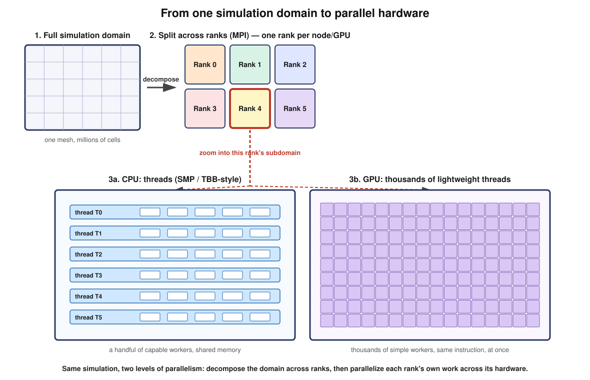

- **Level 1 — domain decomposition (MPI).** The full mesh gets split into
  pieces, one per rank. Ranks don't share memory — they're often on
  entirely separate computers — so anything a rank needs from its neighbor
  has to be explicitly sent and received (that's what MPI, the
  Message-Passing Interface, is for).
- **Level 2 — parallelizing *within* one rank.** Once a rank owns its
  piece of the domain, it still has to actually compute the update for
  every cell in that piece. That's where the second level kicks in:
  - **CPU threads (SMP / TBB-style):** a handful of capable workers
    (think 8-64), each one handling a chunk of the subdomain's cells,
    sharing memory with each other.
  - **GPU:** thousands of much simpler workers, all running the exact same
    small calculation on different cells at the same time — CFD is, for
    the most part, exactly this kind of problem (the same update, repeated
    identically across millions of cells), which is why GPUs are so
    effective for it.
- CFE's backend abstraction is built around exactly this split: the same
  solver code runs unmodified on the CPU-threaded backend or the CUDA
  backend, and the same domain-decomposition machinery hands a rank its
  piece of the mesh regardless of which backend that rank then uses
  internally.

---

## Slide: What actually runs on all those threads?

- The objective here is blunt: **thread everything that can be threaded.**
  Almost every expensive step in a CFD solver is the same small
  calculation, repeated once per cell — exactly the shape a GPU wants, and
  exactly the shape that's wasted if it's left running one cell at a time
  on a single core.
- In CFD terms, the things actually being parallelized per cell are:
  - **flux evaluation** — computing the numerical flux (Rusanov, HLLC, ...)
    across each cell face;
  - **reconstruction** — estimating the left/right states that feed into
    that flux (MUSCL/minmod and similar limiters);
  - **the residual update** — combining flux differences into each cell's
    actual state change;
  - **time integration** — advancing each cell's state by one Runge-Kutta
    stage;
  - **ghost-cell fills** — applying boundary conditions (periodic, walls,
    inflow/outflow, block interfaces, MPI halos) to every ghost cell.
- **What CFE has actually achieved so far:** every one of those steps is
  written exactly once, as "do this for one cell," and handed to a backend
  that runs it for every cell — on CPU (serial or multithreaded) or on a
  GPU — with no separate GPU-specific rewrite of the numerics. That split
  is already built and has been verified running on real GPU hardware (a
  V100 on PSC Bridges-2), not just reasoned about on a CPU.
- Put together with the domain decomposition from the last slide, the full
  picture looks like:
  **domain → decomposed across ranks → ranks placed on nodes of a
  cluster → on each node, either further decomposed across that node's
  GPUs, or threaded across whatever CPU cores are available if there's no
  GPU.**
- That last step — splitting a single node's work across *multiple* GPUs
  on that node — is the next frontier, not something finished yet. Today,
  CFE's MPI layer hands each rank a subdomain and that rank runs it on one
  backend (threaded CPU, or one GPU). Extending that to multiple GPUs per
  node is the natural next layer once this one is solid.

---

## Slide: Where we are with the physics

*One correction before the equations: what's actually implemented and
tested so far is the **compressible Euler** equations (inviscid gas
dynamics) — not yet the full compressible **Navier-Stokes** equations.
Navier-Stokes adds viscous stress and heat conduction on top of Euler,
and that's the next phase on the roadmap, not something built yet. The
three below are what's real today, and they already show the complexity
ramp clearly.*

**1. Scalar transport — one linear equation, one unknown**

```
∂φ/∂t + ∇·(u φ) = 0
```

`φ` is the transported quantity, `u` is a given (fixed) velocity field.
Linear: the thing being transported doesn't affect how fast it moves.

**2. Burgers' equation — one nonlinear equation, one unknown**

```
∂u/∂t + ∂/∂x ( u²/2 ) = 0        (equivalently: ∂u/∂t + u ∂u/∂x = 0)
```

Still a single unknown, but now nonlinear — `u` is both the transported
quantity *and* its own transport speed. That self-interaction is exactly
what lets smooth initial data steepen into a genuine shock, which is why
Burgers' equation is the standard stepping stone to real shock-capturing
before taking on a full system of equations.

**3. Compressible Euler — a coupled nonlinear system, five unknowns (3D)**

```
∂ρ/∂t       + ∇·(ρu)                    = 0        (mass)
∂(ρu)/∂t    + ∇·(ρu⊗u + pI)             = 0        (momentum, 3 components)
∂E/∂t       + ∇·((E + p) u)             = 0        (energy)

closed by the ideal-gas equation of state:
p = (γ - 1) ( E - ½ ρ |u|² )
```

This is no longer one equation — it's a coupled system (mass, momentum ×3,
energy), and the nonlinearity now produces real gas-dynamics behavior:
shocks, contact discontinuities, and rarefaction fans, all at once. CFE
resolves this with MUSCL reconstruction and a choice of numerical flux
(Rusanov or HLLC), verified against the canonical Sod shock tube and
Shu-Osher problems.

**The complexity ramp, in one line:** one linear scalar unknown → one
nonlinear scalar unknown → a coupled nonlinear system of five unknowns.
Navier-Stokes is the next rung: the same system above, plus viscous
stress and heat-conduction terms on the right-hand side.

---

## Slide: Results — 1D verification against known answers

*Every case here is compared against a known exact or analytic answer,
not just "it looks right." Each one is also a regression test in
`tests/`, so it is rechecked automatically on every change.*

**Linear scalar transport** (`∂φ/∂t + a ∂φ/∂x = 0`): the exact answer
is just the initial profile, shifted by `a·t`.

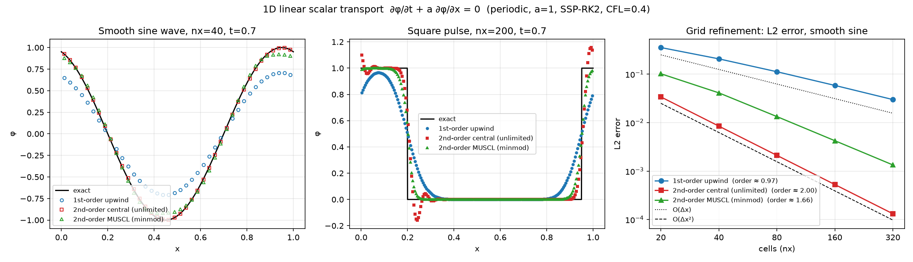

- **Smooth sine wave:** each time the grid is refined 2×, the
  second-order scheme's error drops by exactly 4.0× (measured order
  2.00), and the first-order scheme's error drops by about 2× (order
  0.97). Those are the textbook rates. The regression test
  (`test_scalar_advection_second_order_convergence`) fails if that
  ratio leaves the 3.5-4.5 range.
- **Square pulse:** this shows why limiters exist. The unlimited
  central scheme overshoots and rings at the jumps. First-order upwind
  stays bounded but smears the pulse badly. MUSCL with a minmod limiter
  keeps the edges sharp with no overshoot. It pays for that by dropping
  to about order 1.7 at smooth peaks, a known and expected trade-off.

**Burgers — a moving shock:** the numerical shock lands where the exact
Rankine-Hugoniot speed puts it, at every output time.

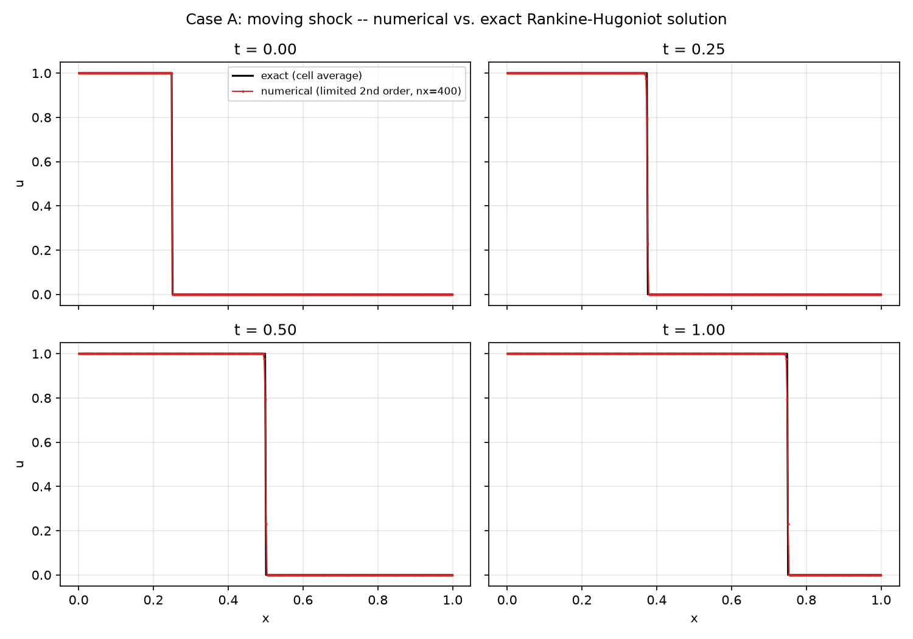

**Euler — the Sod shock tube:** a rarefaction, a contact, and a shock
all form from one initial jump. The result matches the closed-form
exact solution with both numerical fluxes.

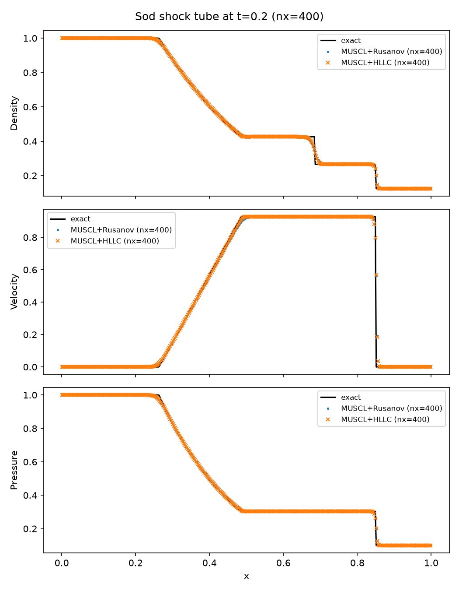

**Euler — Shu-Osher:** a Mach-3 shock running into a sine-wave density
field. There's no exact solution, so the test is how much fine
post-shock structure a scheme can keep. The reference is a run at
nx=2000.

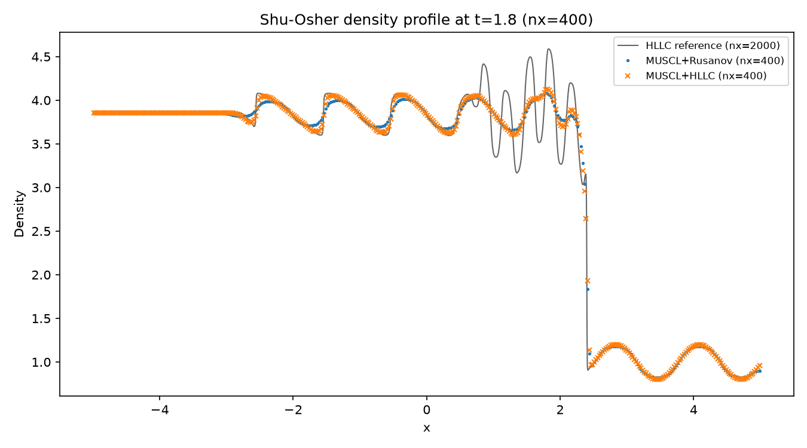

**Euler — a propagating shock, with its speed measured:** a Mach-2
shock is tracked over time and its speed is fitted. The exact speed is
**2.366432**. The error shrinks steadily as the grid is refined, from
8×10⁻³ at nx=100 to 4×10⁻⁵ at nx=800. Both fluxes agree with each other
to within ~10⁻⁴.

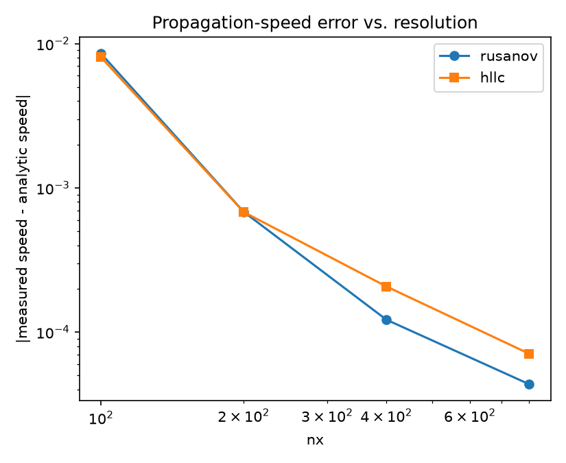

---

## Slide: Results — the Mach 3 forward-facing step

- This is the classic Woodward & Colella (1984) benchmark: Mach 3 flow
  in a wind tunnel with a step in the floor. It is CFE's first
  multi-dimensional, multi-block Euler case. It has been run at seven
  resolutions, from 20 to 288 cells per unit height, with both Rusanov
  and HLLC fluxes, out to t=4.

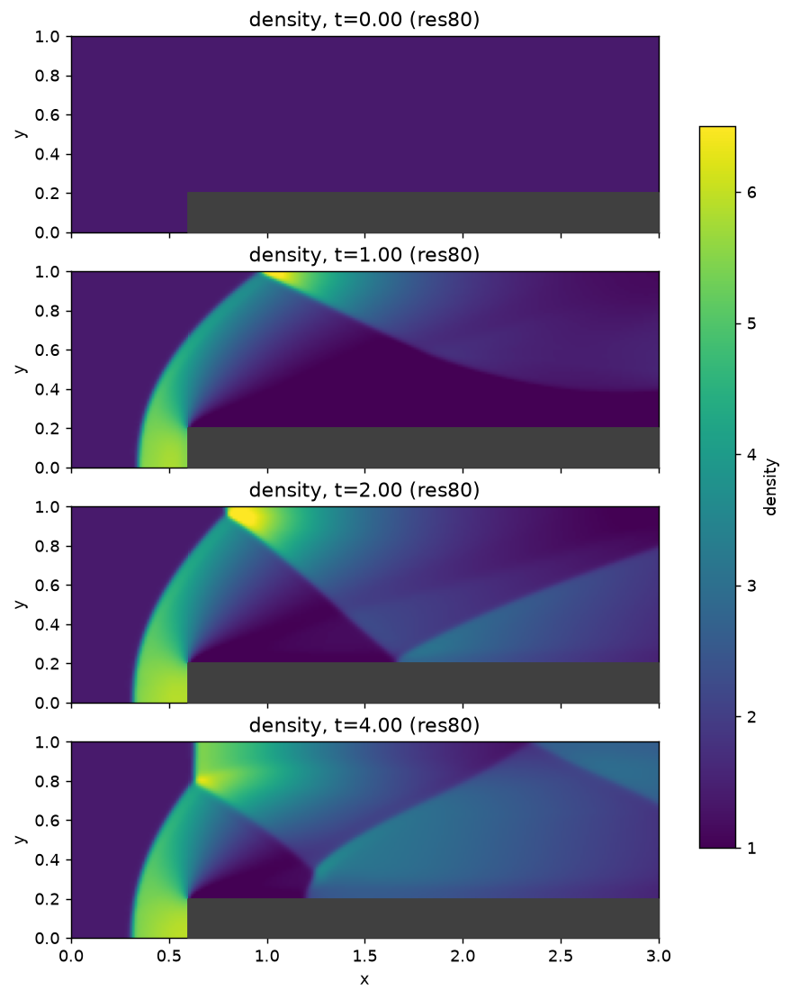

- **The flow features the paper describes all show up:**
  - a bow shock off the corner of the step;
  - shock reflections off the top wall and the step;
  - a Mach stem on the top wall that forms around t≈1.5 and then
    creeps **upstream** (from x≈0.86 at t=1.5 to x≈0.64 at t=4).
    Woodward & Colella describe exactly this ("moves very slowly
    upstream along the upper wall").

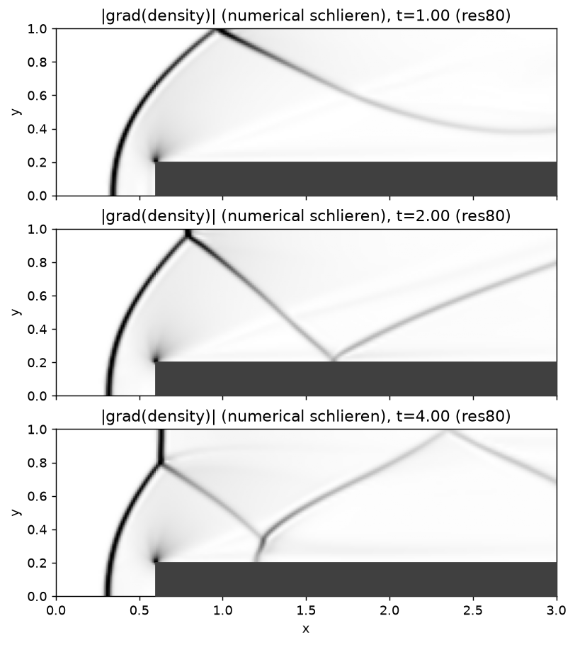

- **The choice of flux matters here, and the results show it.** With
  Rusanov, the trailing contact discontinuity stays a smooth, smeared
  line at every resolution. HLLC resolves contacts more sharply, and
  with HLLC the contact develops the mild "flag-waving"
  (Kelvin-Helmholtz) instability the paper reports, appearing at
  t≈2.5-3 just as the paper says.

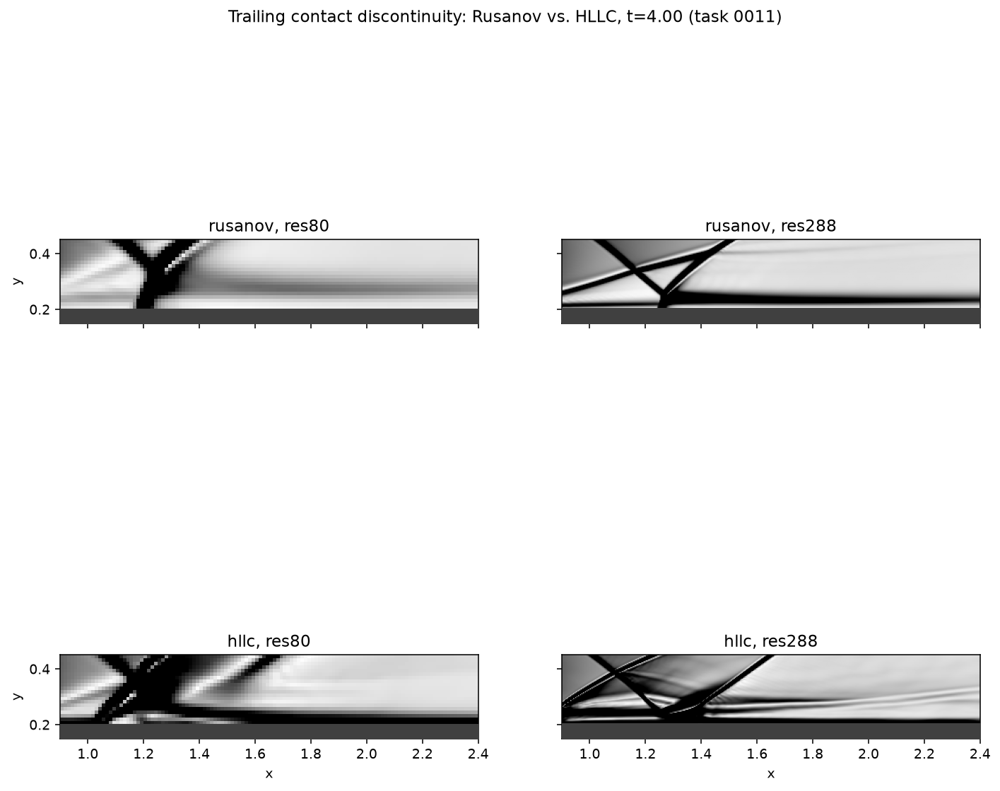

- **The 3D version works too.** The same case extruded in z (periodic
  in z) gives a mid-span slice at t=4 that is **bit-identical** to the
  2D run (max difference exactly 0), and z-momentum stays exactly zero.

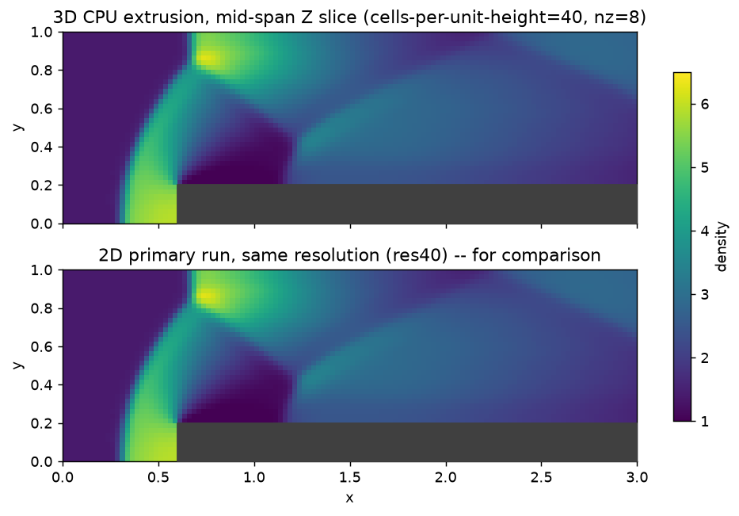

- **Limits so far:** the KH result is a qualitative match, not a
  grid-converged growth-rate study. Multi-block Euler runs on CPU only
  (threaded) today, and has not yet been connected to MPI or tested at
  scale on GPU.

---

## Slide: Results — 3D, split across 8 MPI ranks

**3D Burgers: a shock forming in three directions at once.** A Gaussian
bump (`u = 1 + 0.5·exp(-r²/(2·0.12²))`) on a periodic **128³ grid**
(2.1 million cells), split across **8 MPI ranks** (a 2×2×2 block
decomposition), using MUSCL + Rusanov + SSP-RK2. That's the same
building blocks as the 1D results, now in 3D and in parallel.

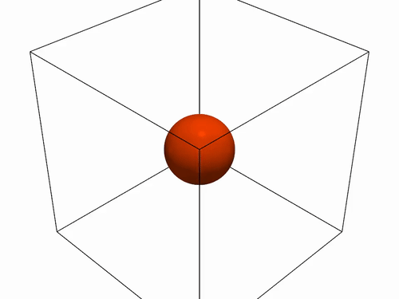

[Full-quality MP4](images/burgers_3d_isosurface.mp4)

- **What you're seeing:** in Burgers' equation, each point moves at its
  own local value of `u`. The tall center of the bump outruns its
  edges, so the **leading faces steepen into a shock** and the
  **trailing faces spread into a rarefaction** in all three directions
  at once.
- The run goes to `t = 1.2`, about **3× the analytic shock-formation
  time** (`t_s ≈ 0.396`), so the shock is fully developed.
- **It drifts and wraps around the box, and that's correct.** The
  background state `u = 1` also moves (Burgers' speed is never zero
  here), so the whole solution travels through the periodic boundaries.
  The pieces at the cube's corners at the end are the bump coming back
  in from the other side.
- **The shock crosses rank boundaries cleanly.** Each rank writes only
  its own 64³ block, and the video stitches the 8 pieces back together.
  There are no seams where the shock passes from one rank to the next,
  because the MPI halo exchange (the ghost cells from earlier) does its
  job.
- **Checked, not just viewed:** the solution never goes above its
  initial maximum (1.49921) or below its minimum (1.0), on any rank, in
  any frame. That's the no-new-oscillations guarantee the limiter is
  supposed to give, confirmed from the output data.
- **A real bug this case catches:** each rank only sees its own part of
  the bump, so each one computes a different local maximum speed. If
  every rank picked its own time step, they would fall out of sync and
  the run would hang. All ranks agree on one global time step (an
  `MPI_Allreduce`), and a dedicated MPI test breaks this on purpose to
  prove it matters.

**3D linear scalar transport, the companion case:** a smaller Gaussian
bump carried diagonally at velocity (1, 1, 1) through the same periodic
128³ box on 8 ranks. The exact answer is a rigid translation, so the
bump should keep its shape as it crosses rank boundaries, and it does.

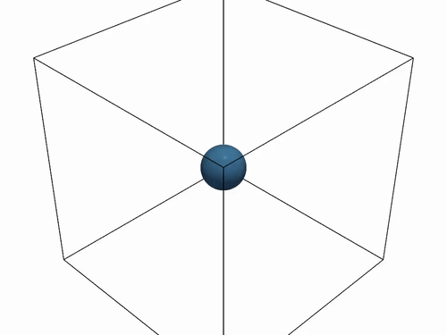

[Full-quality MP4](images/scalar_advection_3d_isosurface.mp4)

These two runs are the same 128³ problems timed on the next slide.

---

## Slide: Results — strong scaling

- **What strong scaling tests:** keep the problem size fixed (a 128³
  global mesh), split it across more MPI ranks, and see whether the
  run gets proportionally faster. Perfect scaling means 2× the ranks
  gives half the time.
- These runs used PSC Bridges-2 (RM-shared, dedicated cores) with a 3D
  block decomposition at 1, 2, 4, and 8 ranks.

| Problem (128³) | 1 rank | 2 ranks | 4 ranks | 8 ranks | Efficiency @ 8 |
|---|---:|---:|---:|---:|---:|
| Scalar advection | 57.5 s | 29.3 s (1.97×) | 14.7 s (3.90×) | 7.56 s (7.61×) | **95%** |
| Burgers (shock forming) | 575 s | 288 s (2.00×) | 150 s (3.84×) | 76.6 s (7.50×) | **94%** |

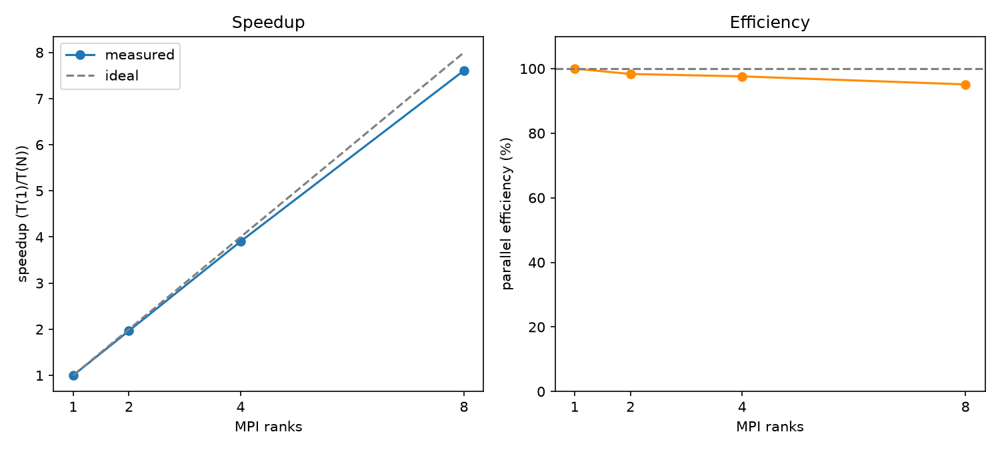

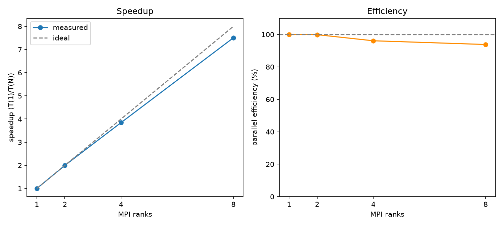

- Both equations scale **near-ideally** up to 8 ranks (94-95%
  efficiency). Burgers does far more work per cell (limiter, nonlinear
  flux), yet its scaling curve has the same shape.
- **Why test locally first, then confirm on the cluster:** on a
  laptop, the same runs top out around 4 ranks. That's because of
  shared cores and memory bandwidth, not the solver, and the dedicated
  cluster cores confirm it.
- **Limits:** this is CPU MPI only, up to 8 ranks, for scalar
  advection and Burgers. Euler has not yet been connected to MPI.
  Larger rank counts, weak scaling, and multi-GPU runs are the next
  steps.

---

## Slide: Numerics implemented so far

*Each piece is written once as "do this for one cell or one face." Any
field can use any of them where it makes sense, and they all run
unchanged on serial CPU, threaded CPU, and CUDA, in both float and
double precision.*

| Category | What CFE has | Notes |
|---|---|---|
| **Physics (fields)** | Scalar advection, Burgers, compressible Euler (1D/2D/3D) | Euler uses an ideal gas with γ = 1.4 |
| **Spatial discretization** | Cell-centered finite volume on structured Cartesian blocks | |
| **Reconstruction** | 1st-order (piecewise constant), 2nd-order central (unlimited), **MUSCL + minmod limiter** | MUSCL is the shock-capturing default |
| **Numerical flux** | **Upwind** (linear scalar) | exact upwinding for a known velocity |
| | **Rusanov / local Lax-Friedrichs** (scalar and system) | robust, simple, but over-smears contacts |
| | **HLLC** (Euler) | models the contact wave separately, so contacts stay sharper |
| **Time integration** | SSP-RK2 with an adaptive, CFL-based time step | |
| **Boundary conditions** | periodic, fixed state, inflow/outflow, slip wall, **block interface**, **MPI halo** | all fill ghost cells through one shared mechanism |

- **Rusanov vs. HLLC, in measured numbers:** on Sod, HLLC's contact is
  about 20-25% narrower at every resolution (e.g. 13 vs. 17 cells at
  nx=400). On Shu-Osher, HLLC holds the region ahead of the shock
  exactly steady, while Rusanov slowly diffuses it. On the forward step,
  only HLLC shows the Kelvin-Helmholtz waviness.
- **The cost of HLLC:** it is noticeably more expensive per face. On
  the finest forward-step grid, the run took 850 s with HLLC vs. 88 s
  with Rusanov. That ratio comes from a single run, so treat it as a
  direction, not a precise number.

---

## Slide: Multi-block domains

- **The problem:** a single Cartesian box can't represent an L-shaped
  domain like the forward-step tunnel. One option is to mesh the whole
  bounding box and mask out the cells inside the step. That wastes
  storage and puts special cases into every kernel.
- **What CFE does instead:** it builds the domain from **several
  ordinary Cartesian blocks** and joins them with a boundary condition.

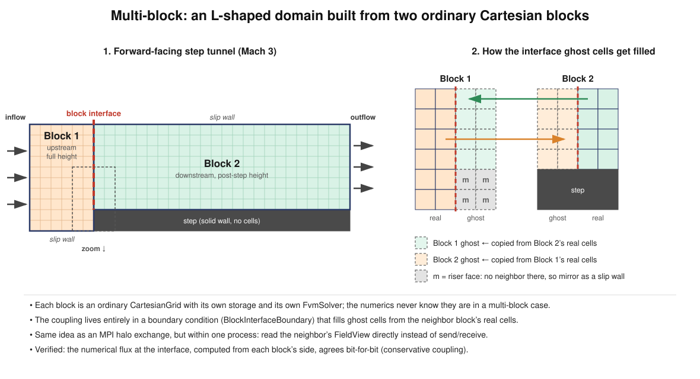

- Each block keeps its own grid, its own storage, and its own solver.
  The flux, reconstruction, and time-stepping code has **no idea** it
  is running in a multi-block case.
- `BlockInterfaceBoundary` fills each block's ghost cells at the
  interface by copying the neighbor block's real cells. Where the
  neighbor doesn't exist (the riser face of the step), it falls back to
  a slip-wall mirror.
- This works the same way as the MPI halo exchange from earlier: same
  ghost-cell idea, but the neighbor is in the same process, so it reads
  memory directly instead of sending a message.
- **Verified:** the numerical flux at the interface, computed separately
  from each block's side, agrees **bit-for-bit** (in both float and
  double). That means no mass, momentum, or energy is created or lost
  at the seam.
- **Next:** more than two blocks, general block connectivity, and
  running multi-block cases across MPI ranks and GPUs.

---

## Slide: Restart files (checkpoint/restart)

- **Why we needed it:** the finest forward-step run (288 cells per unit
  height, HLLC, about 12,000 steps) takes around **15 minutes**.
  Re-checking anything near the end of that run meant redoing all of
  it from t=0.
- **What it does:** it writes a compact, versioned binary checkpoint
  holding the grid metadata, every block's real-cell data, and the step
  count and time. A fresh process can then load it and continue.
  - Ghost cells are deliberately left out of the file. Before every
    residual evaluation, the solver rebuilds them from the real cells
    and the boundary conditions, so they never need saving.
  - A format version number lets future files (for example, ones that
    carry chemical-species data) reject an incompatible old file
    instead of silently misreading it.
- **The correctness bar:** a run that stops, writes a checkpoint, and
  resumes must end up **bit-for-bit identical** to a run that never
  stopped. This is tested on the real two-block forward step, in 2D and
  3D, with both Rusanov and HLLC.
- **Measured payoff** (res288 with HLLC):

| | steps | wall-clock |
|---|---:|---:|
| Full run from scratch | 12,000 | 886 s (~14.8 min) |
| Resume the last 1,000 steps from a checkpoint | 1,000 | 78 s |

  That's **~11× faster** to recheck the end of the run. The checkpoint
  is 6.7 MB and takes about 3 ms to load, which is negligible.
- **Status and limits:** this is in review (PR #10, not merged yet). It
  is CPU-only, and checkpoints are only valid on the same machine and
  build that wrote them. Restart for MPI multi-rank runs is not built
  yet.

---

## Slide: Where we're going next

**1. Compressible Navier-Stokes. This is the top priority.**

- Everything so far is inviscid, so there are only convective
  (hyperbolic) fluxes. Navier-Stokes adds the **diffusive fluxes**:
  viscous stress in the momentum and energy equations, and heat
  conduction in the energy equation.

```
∂(ρu)/∂t + ∇·(ρu⊗u + pI) = ∇·τ                       τ = μ(∇u + ∇uᵀ) - ⅔μ(∇·u)I
∂E/∂t    + ∇·((E + p)u)  = ∇·(τ·u) - ∇·q              q = -k∇T
```

- **Why this comes before chemistry:** a reacting flow is held up by
  diffusion, not just convection. Species diffuse, heat conducts, and
  flames and boundary layers depend on both. Getting the diffusive-flux
  machinery right on plain Navier-Stokes means chemistry later only
  adds species diffusion and source terms on top of something already
  verified. We won't have to build diffusion and chemistry at the same
  time.
- The diffusive flux will be built like the convective fluxes: written
  once per face, and run unchanged on CPU and GPU and across MPI ranks
  and multiple blocks.
- **How we'll verify it:** grid-refinement studies showing the viscous
  terms converge at second order, as the inviscid schemes were checked.

**2. Compressible boundary layer simulations.**

- A compressible flat-plate boundary layer is the first real
  Navier-Stokes target, because it needs exactly what we're adding:
  viscous no-slip walls, the viscous and thermal layers at the wall,
  and the diffusive fluxes driving both.
- It has well-established reference solutions (similarity solutions)
  to compare against, the same way Sod and the forward step anchored
  the Euler work.
- It also leads directly to the reacting flat plate later on.

**3. Reacting flow, targeted for January.**

- Chemistry will come from **ChemGen**, which generates the chemistry
  code (thermodynamics, reaction rates, source terms) that CFE then
  calls.
- This is the step CFE was built for: species already have room in the
  field and storage design (first slide), so adding them should not
  need a rework.
- Chemistry gets verified on its own before it is coupled to the flow:
  0D reactor checks, species conservation, and thermodynamic
  consistency.

**In one line:** inviscid Euler (done) → compressible Navier-Stokes,
verified on compressible boundary layers → chemically reacting flow via
ChemGen in January.

---

## Slide: How the code gets written — a team of agents

**Before:** one AI assistant, one conversation. I said what to build,
and the same assistant wrote the code, tested it, and judged whether it
was done. Nobody checked its work independently, and lessons were lost
at the end of every session.

**Now:** the work is split across seven specialized agents. **One
agent writes code. Six others review it, each from one angle, and they
can only propose changes, not make them.** The rules are written down
in the repo (`CLAUDE.md` and `.claude/agents/`) and tracked in Git.

| Agent | Objective | How they work with the others | Allowed to |
|---|---|---|---|
| **Robby the Robot** — main developer | Turn my objectives into requirements and acceptance criteria, then write the smallest change that meets them | Consults reviewers *before* big design decisions; applies their fixes and integrates everything | **Edit production code** (the only agent that can) |
| **Violet the Verifier** — numerical correctness | Check the method is actually *right*, not just running: convergence rates, conservation, shock position and speed, exact solutions | Keeps *regression* ("matches last time") separate from *verification* ("matches the true answer"); teams up with Enzo when speed changes touch numerics | Read and run tests; propose fixes |
| **Snorlax the Lazy** — simplicity | Remove duplication, needless wrappers, and abstractions built for hypothetical future needs | Keeps solver orchestration readable and flux and reconstruction details in their own components; aims for less effort for the next reader, not fewer lines | Read only; propose fixes |
| **Sally the Student** — usability | Read the code as a PhD student who knows Python and is learning C++ | Makes sure templates, ownership, indexing and memory layout are explained where a student first meets them; **actually runs the tutorials** | Read and run tutorials; propose fixes |
| **Enzo the Enforcer** — performance | Catch extra allocations, copies, synchronization, and unintended CPU↔GPU transfers in hot loops | **No performance claim without a measurement**; never assumes fewer lines means faster | Read and run benchmarks; propose fixes |
| **Ilia the Impartial** — final review | Check whether the evidence really supports the claims, and whether tests could pass even if the code were wrong | Reviews last and **forms an opinion before reading anyone else's findings**, then checks how their findings were resolved | Read and run tests; propose fixes |
| **Amelia the Architect** — direction | Keep every change aligned with CFE's goal: reacting flows, many methods, at scale, accessible to students | Consulted before major architecture decisions and checks direction at the end; blocks building for needs we don't have yet | Read only; propose fixes |

**How they work together**

```
Robby: scope + acceptance criteria ──▶ consult (Amelia / Enzo / Violet) ──▶ implement
   ──▶ Violet · Snorlax · Sally · Enzo review ──▶ Robby resolves findings ──▶ re-run checks
   ──▶ Ilia (independent) + Amelia (direction) ──▶ Robby reports evidence + remaining limits
```

- Every finding gives the location, the issue, the consequence, and a
  proposed fix, and is labeled **blocking** or **optional**.
- Hard rules: never weaken a test just to make code pass, and never
  report a test as passed unless it was actually run.
- Effort matches the size of the change. A typo fix skips the process;
  numerics, solver, memory-layout or GPU changes get every relevant
  review.
- **Lessons last between sessions.** Each agent records durable lessons
  in its own file under "Accumulated knowledge", so the same mistake
  isn't repeated next time.

**How this has helped: real catches from this project**

- **Ilia** found that a Shu-Osher result in the tutorial combined two
  separate effects into one number. It was split into two honest
  measurements before the work was closed.
- **Ilia** also flagged that HLLC was missing a 3D CUDA benchmark at
  scale. It was added before the task was called done.
- **Enzo** found that a float-vs-double timing showing "no speedup"
  was measured while other jobs were running on the machine. A clean
  rerun found a real speedup.
- **Enzo** also measured that an "obviously faster, fewer copies" way
  of writing restart files was actually **2.5-4× slower**.
- **Enzo** marked the HLLC-vs-Rusanov cost ratio as coming from one
  unrepeated run, so it is reported as a trend, not a precise number.
- **Violet** re-derived a test's claimed tolerance margin herself and
  found the claim was wrong.
- **Violet** also predicted what the forward-step Kelvin-Helmholtz
  result should look like *before* the run, so the result couldn't be
  overclaimed afterward.
- **Amelia** kept PPM deferred instead of building it early just
  because HLLC alone reproduced the Kelvin-Helmholtz feature.
- **Sally** made sure a new C++ pattern (RAII: cleanup tied to an
  object's lifetime) is explained the first time a student meets it,
  compared to Python's `with` block.
- **Snorlax** steered toward reusing only the parts that are truly
  shared, instead of forcing every boundary condition into one generic
  shape.

**The net effect:** the code is checked by reviewers whose only job is
to find problems, from angles a single assistant tends to skip. The
claims in these slides, from convergence rates to scaling numbers to
restart speedups, come with evidence and stated limits because the
process requires it.

---

## Slide: Outlook — from Cartesian blocks to unstructured grids and finite elements

**Where we are:** everything so far runs on structured Cartesian
blocks. But the code was deliberately built so that **the grid is only
one piece of it, not something everything else depends on**:

- the physics (fields) only says "here is my flux and my wave speed";
- the numerical fluxes (Upwind, Rusanov, HLLC) only see a *left state*
  and a *right state* across one face;
- time integration, the CPU/GPU backends, and MPI work on lists of
  cells, not on `(i, j, k)` grid indices.

The grid-specific parts are contained: indexing, the reconstruction
stencil, and how ghost cells get filled.

**Ghost cells are really just "the state on the other side of a face."**
We've already used one idea for four different jobs:

| Where the face is | Where the "other side" state comes from |
|---|---|
| Physical boundary | boundary condition (wall, inflow, periodic, ...) |
| Between two blocks | neighbor block's real cells (`BlockInterfaceBoundary`) |
| Between two MPI ranks | message from the neighbor rank (halo exchange) |
| **Unstructured mesh (next)** | **neighbor element, found through a face-connectivity list** |
| **Finite element / DG (next)** | **neighbor element's polynomial evaluated on the shared face** |

In each case the update reduces to the same pattern: get the state on
each side of a face, apply a numerical flux, and add up the
contributions. The step to unstructured grids **generalizes that
communication between cells** from "the next index over" to "whatever
element shares this face."

**Why this leads naturally to finite elements: the weak form.** Take
the conservation law `∂q/∂t + ∇·F(q) = 0`, multiply by a test
function `v`, integrate over one element `K`, and integrate by parts:

```
∫_K v ∂q_h/∂t dV  −  ∫_K ∇v · F(q_h) dV  +  ∮_∂K v F̂(q⁻, q⁺)·n dS  =  0
   time change         volume term            face term: numerical flux
                                                between this element (q⁻)
                                                and its neighbor (q⁺)
```

This is **Discontinuous Galerkin (DG)**. Inside each element, the
solution is a polynomial of degree `p`, and neighbors talk **only**
through the face term, using exactly the same numerical fluxes we
already have (Rusanov, HLLC).

**DG with p = 0 *is* finite volume.** With `p = 0`, the solution is
one constant per element and the test function is `v = 1`. Then
`∇v = 0`, so the volume term vanishes and what's left is:

```
|K| dq̄_K/dt  +  Σ_faces |f| F̂(q̄_K, q̄_neighbor)·n  =  0
```

That's exactly the cell-centered finite-volume update CFE runs today.
**Finite volume is the bottom rung of the DG ladder.** The two
approaches differ in how they get higher order:

- **Finite volume (MUSCL, later PPM/WENO):** keep one value per cell
  and *reconstruct* a sharper face state from neighboring cells (a
  wider stencil).
- **DG (`p = 1 ... 4`):** store *more information inside each element*
  (polynomial coefficients) and keep the communication between
  neighbors face-only (a compact stencil). That suits unstructured
  meshes and GPUs.

**What this enables:**

- **Hybrid DG/FVM:** the interface between a DG region and an FV
  region is just another face where each side supplies its state and
  they share a numerical flux. It's the same conservative coupling we
  already verified bit-for-bit at the multi-block interface. Different
  regions can then use the method that suits them, for example
  finite volume near shocks and high-order DG in smooth regions.
- **Viscous and reacting terms carry over:** the diffusive fluxes
  we're building for Navier-Stokes become viscous face fluxes in DG,
  and the ChemGen chemistry is a per-cell (or per-quadrature-point)
  source term either way.
- **Complex geometry:** unstructured meshes imported from standard
  tools (Gmsh/CGNS), instead of building every geometry out of
  Cartesian blocks.

**Being honest about what isn't built yet:** unstructured connectivity
(compact adjacency arrays that work well on GPUs), mesh import,
quadrature and basis functions, and DG itself. The roadmap order
stays: Navier-Stokes → boundary layers → chemistry (January) →
unstructured grids and DG/FVM. The point of today's design is that
none of those steps should require rewriting the physics, the fluxes,
or the parallel machinery we've already verified.

---

**In one sentence:** CFE started as finite volume on Cartesian blocks.
Because the physics, the fluxes, and the parallel machinery all talk
in terms of faces and neighbors rather than grid indices, the same
code path leads to unstructured meshes and high-order DG, with
finite volume as its `p = 0` case.

---

## Slide: This is a tool for *you*

**CFE is being built for you to use in your own research.** The goal
is simple: if you have an idea, whether a new flux, a new limiter, a
new set of equations, or a new test case, you should be able to try it
**in days, not months**. Then it should run at scale on CPUs, GPUs and
MPI without you having to become a parallel-computing expert first.

**The agent team from the earlier slide comes with the repo.** Open
CFE in Claude Code and you get the same setup: Robby to implement, and
Violet, Snorlax, Sally, Enzo, Ilia and Amelia to review. You describe
the idea and the science; the agents help you write it, test it, and
check it.

**Why this works: the code is split so each idea has one place to go.**

```
src/cfe/
├── fields/                  ← THE PHYSICS: "what equations am I solving?"
│   ├── scalar_advection/        one file per set of equations
│   ├── burgers/
│   └── euler/
├── numerics/                ← THE NUMERICAL METHOD: "how do I discretize it?"
│   ├── numerical_flux/          Upwind, Rusanov, HLLC
│   └── fvm/                     reconstructions: 1st-order, central, MUSCL-minmod
├── solver/                  ← THE ORCHESTRATION: "in what order do things happen?"
│   ├── explicit/                FvmSolver: fill ghosts → reconstruct → flux → residual
│   └── time_integration/        SSP-RK2
├── grid/                    ← THE MESH: cells, partitions, and boundary conditions
│   ├── structured/              Cartesian grid
│   ├── boundary/                periodic, walls, inflow/outflow, block interface, MPI halo
│   └── partition/               how the domain is split across MPI ranks
├── field/                   ← STORAGE: where the numbers live in memory (CPU or GPU)
├── backend/                 ← EXECUTION: serial, threaded, CUDA, MPI
├── io/                      ← OUTPUT: VTK snapshots, restart files
└── math/, core/             ← small shared utilities and types

tutorials/                   ← runnable examples, each with a README and figures
tests/                       ← unit tests + verification against exact answers
```

These pieces are **independent of each other**. A field doesn't know
which flux will be used, a flux doesn't know which equations it's
solving, and neither knows whether it's running on a laptop or a GPU.

**For example, this is the *entire* definition of Burgers' equation in
CFE:**

```cpp
template <class Scalar, std::size_t Dim>
struct BurgersField
{
  static constexpr std::size_t dim = Dim;
  static constexpr std::size_t n_components = 1;     // one unknown, u

  // physical flux: F(u) = u²/2
  CFE_HOST_DEVICE
  Scalar physical_flux(Scalar state, Axis) const { return Scalar(0.5) * state * state; }

  // fastest signal speed at a face: max(|u_L|, |u_R|), used by Rusanov
  CFE_HOST_DEVICE
  Scalar wave_speed(Scalar state_left, Scalar state_right, Axis) const { ... }
};
```

That's the whole physics. Everything else comes from the rest of CFE:
MUSCL, Rusanov, SSP-RK2, boundary conditions, MPI, and GPU execution.

**So if you want to try...**

| I want to try... | Where it goes | What you actually write |
|---|---|---|
| a new set of equations | `fields/<your_equations>/` | the physical flux and wave speed |
| a new numerical flux (Roe, HLL, AUSM, ...) | `numerics/numerical_flux/` | a function of (left state, right state) |
| a new limiter / reconstruction (WENO, PPM, ...) | `numerics/fvm/` | face values from neighboring cells |
| a new time integrator (RK3, RK4, ...) | `solver/time_integration/` | how stages combine residuals |
| a new boundary condition | `grid/boundary/` | how to fill the ghost cells |
| a new test case | `tutorials/` + `tests/verification/` | initial conditions, an exact or reference answer, plots |

**What working with the agents looks like:**

1. **You bring the science.** "I want to try an HLL flux on the
   Shu-Osher problem and compare it with HLLC."
2. **Robby** finds where it goes, reuses the existing pieces, and
   writes the smallest change needed. The new piece runs on the same
   CPU and GPU backends as everything else, because those layers don't
   change. MPI works the same way wherever it has been connected
   (scalar advection and Burgers today; Euler is next).
3. **Violet** checks it's actually right (convergence rates, exact
   solutions, shock speeds). **Sally** checks it's explained so the
   next student can follow it. **Enzo** checks it isn't needlessly
   slow.
4. **You get back** working code, a test, and a tutorial with figures,
   plus an honest list of what was and wasn't verified.

**Ground rules (for you and the agents):**

- **You are still the scientist.** The agents speed up implementation
  and checking, but you decide what the right reference solution is
  and whether a result makes physical sense.
- **Nothing counts until it's verified.** "It ran and the plot looks
  reasonable" is not a result. Compare against exact solutions,
  convergence rates, or published benchmarks, as every result in this
  deck did.
- **Read what gets written.** The code is meant to be readable by a
  PhD student learning C++, and Sally's job is to keep it that way. If
  something is unclear, ask, then fix the explanation.

**The goal: you spend your time on the numerical methods and the
physics you care about, and CFE plus the agents handle the plumbing.**

---

## Slide: The end goal — what running CFE looks like for a user

*This is where the project is headed, not what exists today. Today,
each case is a small C++ driver in `tutorials/`. The target is that a
user who **isn't** writing new numerics can run a simulation with
**two files and no C++**.*

**File 1: the domain (the grid).** Make the mesh in a standard meshing
tool such as Gmsh, or export CGNS from another tool, and name the
boundary surfaces (`inlet`, `wall`, `outlet`, ...). CFE imports it. No
more building every geometry out of Cartesian blocks by hand.

**File 2: the case configuration (`case.yaml`).** Everything about
*how* to solve the problem goes in one readable file: the equations,
the numerical method, the flux, the chemical mechanism, boundary
conditions, run length, output, and hardware.

```yaml
# case.yaml — illustrative: a reacting supersonic flat plate (target format, not final)

domain:
  mesh: meshes/flat_plate.msh          # from Gmsh; boundary names come from the mesh

build:                                 # fixed when the executable is built (for speed)
  dimension: 2
  precision: double
  backend: cuda                        # serial | threaded | cuda
  equations: navier_stokes             # euler | navier_stokes | ...
  chemistry:
    mechanism: mechanisms/h2_air.yaml  # ChemGen generates the chemistry code from this
  method: fvm                          # fvm | dg
  reconstruction: muscl_minmod         # fvm only
  # polynomial_order: 2                # dg only
  numerical_flux: hllc                 # rusanov | hllc | ...

run:                                   # read when the run starts; change freely, no rebuild
  time_integration: ssp_rk2
  cfl: 0.4
  final_time: 2.0e-3
  initial_condition:
    type: uniform
    mach: 2.5
    pressure: 1.0e5
    temperature: 300.0
    composition: { O2: 0.233, N2: 0.767 }
  boundaries:                          # names match the surfaces in the mesh file
    inlet:  { type: supersonic_inflow }
    outlet: { type: outflow }
    plate:  { type: no_slip_wall, temperature: 1200.0 }
    top:    { type: slip_wall }

output:
  every: 1.0e-5
  format: vtk                          # open in ParaView
  restart_every: 1.0e-4                # checkpoints, as shown earlier

parallel:
  mpi_ranks: 8                         # one GPU per rank on the cluster
```

**What happens when you run it:**

```
 flat_plate.msh  +  case.yaml
          │
          ▼
  cfe build case.yaml   →  builds an executable specialized for THIS case
          │                 (dimension, precision, backend, equations,
          │                  chemical mechanism, flux, method)
          ▼
  cfe run case.yaml     →  laptop, workstation, or cluster (MPI + GPUs)
          │
          ▼
  VTK output (ParaView) + restart checkpoints + run log
```

*(The command names are illustrative.)*

**Why there are two kinds of settings:**

- **Build settings** (equations, flux, method, mechanism, precision,
  backend) decide *which C++ code gets compiled*. Fixing them when the
  executable is built lets the compiler produce fast, specialized code
  for exactly that combination. That matters on GPUs and with many
  chemical species. Changing one just triggers an automatic rebuild,
  and the user never edits C++.
- **Run settings** (CFL, final time, initial conditions, boundary
  values, output) are read at startup, so you can sweep them without
  rebuilding.
- **Design rule:** the YAML is read once, up front, and turned into
  the right C++ types. The physics and flux kernels never read the
  config file themselves. That keeps them fast and keeps every piece
  testable on its own, as it is today.

**What this means for the different people using CFE:**

| Who | What they touch | Example |
|---|---|---|
| **Someone running simulations** | a mesh + `case.yaml` | "Run this geometry with HLLC and the H₂-air mechanism at Mach 2.5." |
| **Someone comparing methods** | one line of `case.yaml` | `numerical_flux: rusanov` → `hllc`, or `method: fvm` → `dg` |
| **Someone developing methods** (you, with the agents) | one new file in `fields/` or `numerics/` | add a new flux, and it becomes one more option in the YAML for everyone |

**This is the full picture.** Everything we've built (verified fluxes,
multi-block and MPI ghost-cell communication, GPU backends, restart
files) and everything coming next (Navier-Stokes, ChemGen chemistry,
unstructured grids, DG) becomes **an option in a configuration
file**. A new method a student builds this semester becomes something
every other user can select with one line.
