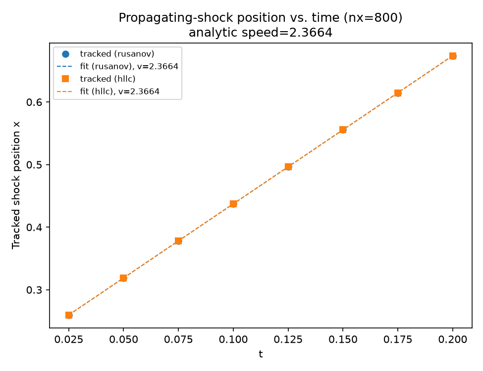
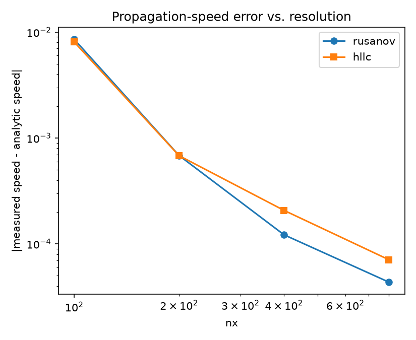

# 1D compressible Euler: a propagating shock with feature tracking

ROADMAP.md Phase 4's "1D propagating shock demonstration and periodic
propagation-speed estimate", added by
`tasks/0013-phase4-propagating-shock-tracking.md`. Same `EulerField` +
`MusclMinmodReconstruction` + SSP-RK2 stack
`tests/verification/test_euler_propagating_shock.cpp` verifies.

## What this demonstrates

A standalone, Mach-2 right-moving shock (gamma=1.4) into otherwise
uniform, at-rest gas -- deliberately **not** a reuse of Sod's own
shock, which sits adjacent to a contact discontinuity that smears
differently between `RusanovFlux`/`HllcFlux` (ADR 0012's own 17-vs-13
cell result) and would risk contaminating a shock-*position*
measurement. A standalone normal-shock jump is also pure closed-form
Rankine-Hugoniot algebra -- no Newton iteration at all:

| | density | velocity | pressure |
|---|---|---|---|
| ahead (`x` large, at rest) | 1.0 | 0.0 | 1.0 |
| behind (`x` small) | 2.666667 | 1.479020 | 4.5 |

Analytic shock speed: `S = M*c_ahead = 2.0 * sqrt(1.4) = 2.366432`. This
simple form (`S` in the LAB frame, not the shock-fixed frame) only holds
because the ahead gas starts **at rest** (`u_ahead=0`) -- a nonzero
ahead velocity would need the jump applied in the shock-fixed frame
first (`rankine_hugoniot_jump.hpp`'s `normal_shock_jump` only handles
the at-rest case, documented in its own header comment).

The shock starts at `x=0.2` in a `[0,1]` domain and is tracked at 8
snapshots (`t=0.025, 0.05, ..., 0.2`) via **interpolated midpoint-density
threshold crossing** (not steepest-gradient -- chosen specifically
because it is insensitive to the different smearing *widths/shapes* the
two fluxes produce, so it does not manufacture a spurious "different
speed" between fluxes that are really just differently smeared, not
differently located). A least-squares linear fit of tracked position
vs. the *actual recorded* simulation time (not an assumed uniform
spacing -- the CFL-adaptive timestep makes that necessary) gives the
measured propagation speed.

## Results: measured vs. analytic speed, both fluxes

| nx | Rusanov speed | Rusanov \|error\| | HLLC speed | HLLC \|error\| |
|---|---|---|---|---|
| 100 | 2.374974 | 0.008542 | 2.374490 | 0.008058 |
| 200 | 2.367114 | 0.000682 | 2.367112 | 0.000680 |
| 400 | 2.366554 | 0.000122 | 2.366639 | 0.000207 |
| 800 | 2.366388 | 0.000044 | 2.366361 | 0.000071 |

Analytic speed: **2.366432**. Both fluxes converge cleanly toward it as
the grid is refined (error decreasing monotonically for each flux
independently), and **agree with each other to within ~0.0001-0.0003 at
every resolution tested** -- both model the same physical shock, as
expected, verified rather than assumed. Neither flux shows a
measurable, resolution-persistent speed bias relative to the other;
the small nx=400/800 differences are consistent with ordinary
discretization noise in the position fit, not a systematic effect.




## Build and run

From the repo root (builds everything else too):

```bash
cmake -S . -B build -DCMAKE_BUILD_TYPE=Release
cmake --build build --target cfe_euler_1d_propagating_shock -j
cd tutorials/euler_1d_propagating_shock
../../build/tutorials/euler_1d_propagating_shock/cfe_euler_1d_propagating_shock
```

Or standalone, from this directory alone:

```bash
cmake -S . -B build -DCMAKE_BUILD_TYPE=Release
cmake --build build --target cfe_euler_1d_propagating_shock -j
./build/cfe-root-build/tutorials/euler_1d_propagating_shock/cfe_euler_1d_propagating_shock
```

Writes `data/summary.csv` (measured vs. analytic speed per flux/
resolution) and `data/tracked_positions.csv` (tracked position at each
snapshot, per flux/resolution).

## Regenerating the figures

```bash
python3 -m venv .venv && source .venv/bin/activate
pip install pandas matplotlib numpy
python3 plot_results.py
```
