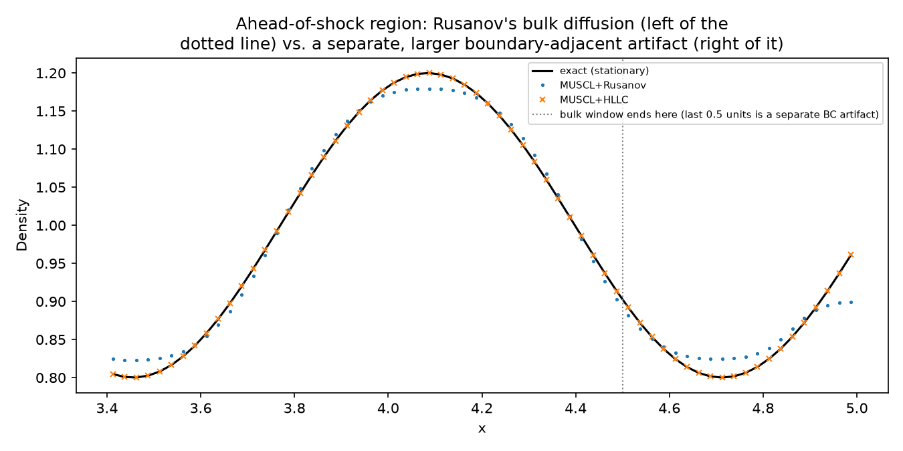
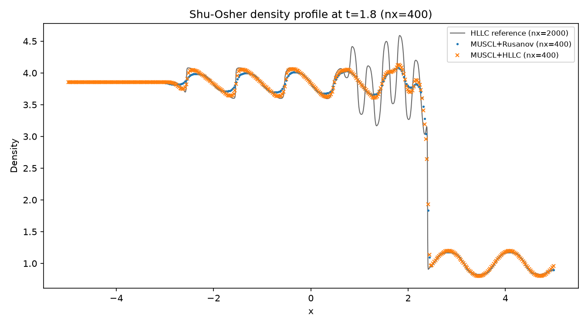
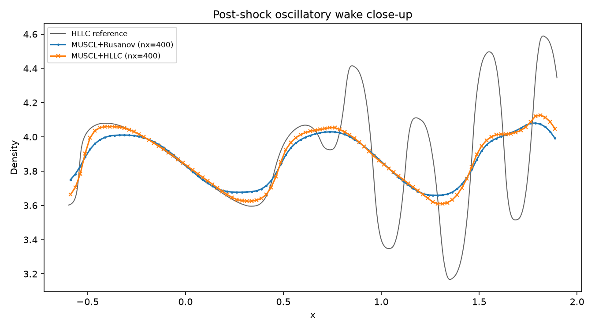
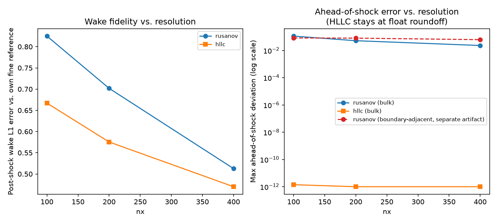

# 1D compressible Euler: the Shu-Osher shock/density-wave interaction

ROADMAP.md Phase 3's second named Euler canonical case alongside Sod
(`tutorials/euler_1d_sod_shock_tube/`), added by
`tasks/0012-phase3-shu-osher.md`. Same `EulerField` +
`MusclMinmodReconstruction` + SSP-RK2 stack
`tests/verification/test_euler_shu_osher.cpp` verifies -- the actual
simulation driver (`cfe_verification::run_shu_osher`,
`tests/verification/shu_osher_setup.hpp`) is the same code both the
unit test and this tutorial call.

## What this demonstrates

Shu & Osher (1989): a Mach-3 shock (gamma=1.4) propagating rightward
through a sinusoidally-perturbed density field, producing fine
post-shock oscillatory structure. Unlike Sod, there is no closed-form
exact solution for the disturbed region -- this is the standard test
for exactly how well a scheme's own numerical dissipation preserves
genuinely nonlinear fine structure, and this tutorial's job is to show,
honestly, how much `RusanovFlux` and `HllcFlux` actually differ on it.

Domain `x in [-5,5]`, shock initially at `x=-4`:

| | density | velocity | pressure |
|---|---|---|---|
| left (post-shock, `x<-4`) | 3.857143 | 2.629369 | 10.333333 |
| right (`x>=-4`) | `1+0.2*sin(5x)` | 0 | 1 |

(Left state is the Rankine-Hugoniot jump for a Mach-3 shock into the
background `rho=1,u=0,p=1` -- cross-checked against both an independent
derivation and the literature; see `tasks/0012-...md`.) Run to `t=1.8`.
Boundary: `InflowOutflowBoundary` (fixed post-shock state at the left,
zero-order extrapolation at the right -- the right edge stays exactly
on the undisturbed initial condition the whole run, verified directly
below, not merely assumed).

## Finding 1 (the more dramatic one): the "undisturbed" region ahead of
the shock is not actually undisturbed under Rusanov

The region ahead of the shock is an **exact, time-independent solution**
of the Euler equations: with `u=0` and `p=1` uniform there, the physical
flux is the exact constant vector `(0, p, 0)` at every face, regardless
of how density is reconstructed (momentum and energy are themselves
already-uniform conserved quantities there, so MUSCL's minmod limiter
reconstructs them to exactly their constant value). So the residual in
this region should be exactly zero, independent of resolution or flux.

**Measured:** `HllcFlux` reproduces this exactly, to floating-point
roundoff, at every resolution tested (100/200/400/800/2000) --
essentially `1e-12` or smaller. `RusanovFlux` does **not**: its own
artificial dissipation acts directly on the conserved density component
(`-0.5*alpha*(q_R-q_L)`, `alpha>0`) even though the physical flux is
exactly constant, so it measurably, if slowly, diffuses the stationary
density perturbation over the course of the run.

**Why, worked through on one face:** take two neighboring cells ahead of
the shock, with densities `rho_L=1.1` and `rho_R=0.9` (both on the
smooth sine wave, `u=0` and `p=1` in both). Rusanov's flux formula is

```
F_rusanov(qL, qR) = 0.5*(F(qL) + F(qR)) - 0.5*alpha*(qR - qL)
```

The first term is exact here: `F(qL) = F(qR) = (0, p, 0) = (0, 1, 0)`
(mass flux `rho*u=0` since `u=0`; momentum flux `rho*u^2+p=p=1`; energy
flux `(E+p)*u=0`) -- so `0.5*(F(qL)+F(qR)) = (0, 1, 0)` too, no error
from this term alone. But the SECOND term, the dissipation, subtracts
`0.5*alpha*(qR - qL)` **component by component**, and the density
component of `qR - qL` is `rho_R - rho_L = 0.9 - 1.1 = -0.2` --
*not* zero, because density genuinely differs between the two cells
even though the flux doesn't care about it when `u=0`. So the density
component of the numerical flux comes out `0 - 0.5*alpha*(-0.2) =
0.1*alpha`, a nonzero NUMBER, even though the true mass flux is exactly
zero at both cells. Over many timesteps this nonzero "phantom" mass
flux nudges density from cell to cell, which is exactly the diffusion
measured below. HLLC never has this problem for a stationary
zero-velocity wave: its contact wave speed `S_star` comes out exactly
`0` here (same-pressure, same-velocity, opposite-side states feed
directly into the formula that already gives `S_star=0` for a pure
contact -- see `test_euler_isolated_contact_hllc.cpp`), which collapses
its flux formula's own correction term to exactly zero rather than
something proportional to the density difference.

**Two separate numbers, not one combined one** (an earlier draft of this
README quoted a single combined "max deviation" here that turned out to
be dominated by a SECOND, unrelated effect -- caught by Ilia's
independent final review before this task was closed; see the figure's
own caption below for the visual version of this same point): the
"bulk" mechanism above (measured excluding the last 0.5 domain-units
next to the right edge, `x<=4.5`), and a separate, larger
**boundary-adjacent artifact** right next to the domain's own edge
(`x>4.5`) -- `InflowOutflowBoundary`'s zero-order extrapolation cannot
exactly represent the CONTINUOUSLY VARYING sine wave the way it can a
genuinely constant far-field state, so it introduces its own,
different, also-resolution-convergent error confined to that narrow
strip. Not investigated further here (out of this task's scope), but
reported honestly rather than folded into the bulk number:

| nx | Rusanov BULK max deviation (`x<=4.5`) | Rusanov BOUNDARY-ADJACENT max deviation (`x>4.5`) | HLLC max deviation (everywhere) |
|---|---|---|---|
| 100 | 0.1127 | 0.0826 | ~1e-12 |
| 200 | 0.0518 | 0.0800 | 0 |
| 400 | 0.0231 | 0.0618 | 0 |

The BULK mechanism (the one this finding is actually about) is a real,
bounded, resolution-convergent artifact, decreasing roughly 2-3x per
grid doubling -- consistent with a numerical diffusivity that shrinks
with `dx`, not a bug, and distinct from (though related to) Rusanov's
already-documented contact-smearing weakness (`numerics/numerical_flux/
rusanov.hpp`). HLLC's exactness (checked over the FULL region, boundary
included) is an extension of its own documented exact-contact-
preservation property
(`tests/verification/test_euler_isolated_contact_hllc.cpp`) to a
*continuum* of stationary entropy waves, not just one discrete jump --
and arguably a more dramatic, visually obvious demonstration of HLLC's
fine-structure advantage than the oscillatory wake comparison below.



## Finding 2: in the post-shock wake, HLLC tracks its own fine reference
more closely than Rusanov, at the same resolution

Measured wake-region L1 error against each flux's own converged
nx=2000 reference (excluding a margin around the shock front itself):

| nx | Rusanov wake L1 error | HLLC wake L1 error | Rusanov extrema (fixed window) | HLLC extrema |
|---|---|---|---|---|
| 100 | 0.8250 | 0.6670 | 5 | 5 |
| 200 | 0.7018 | 0.5754 | 5 | 5 |
| 400 | 0.5127 | 0.4700 | 5 | 7 |

A real, consistent (if modest) advantage for HLLC at every resolution
tested -- the same direction as the forward-step Kelvin-Helmholtz
finding and the Sod contact-width result
(`docs/adr/0012-hllc-numerical-flux.md`), now independently confirmed on
a third, different canonical case. Not dramatic: both fluxes damp the
oscillation amplitude relative to the fine reference, expected for a
2nd-order TVD scheme (Shu-Osher is literature's own standard
illustration of why 5th-order WENO schemes were built; do not expect
either flux here to match a WENO-level reference profile closely).





## Build and run

From the repo root (builds everything else too):

```bash
cmake -S . -B build -DCMAKE_BUILD_TYPE=Release
cmake --build build --target cfe_euler_1d_shu_osher -j
cd tutorials/euler_1d_shu_osher
../../build/tutorials/euler_1d_shu_osher/cfe_euler_1d_shu_osher
```

Or standalone, from this directory alone:

```bash
cmake -S . -B build -DCMAKE_BUILD_TYPE=Release
cmake --build build --target cfe_euler_1d_shu_osher -j
./build/cfe-root-build/tutorials/euler_1d_shu_osher/cfe_euler_1d_shu_osher
```

Writes `data/summary.csv` (wake L1 error, ahead-of-shock max deviation,
and extrema count, per flux, at nx=100/200/400) and
`data/case_nx*_<flux>.csv` / `data/case_fine_<flux>.csv` (full
density/velocity/pressure profiles).

## Regenerating the figures

```bash
python3 -m venv .venv && source .venv/bin/activate
pip install pandas matplotlib numpy
python3 plot_results.py
```
