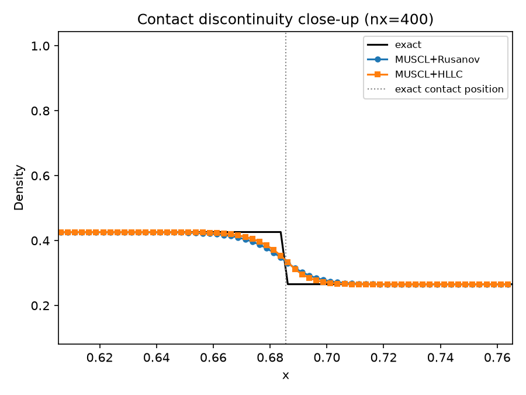
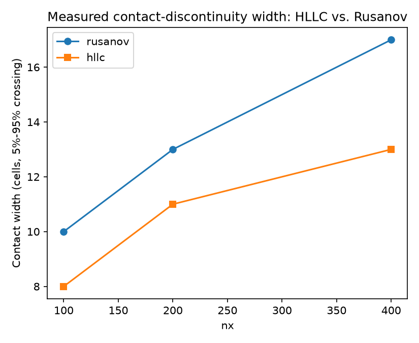

# 1D compressible Euler: the Sod shock tube

Phase 3's companion 1D benchmark (ROADMAP.md) for CFE's first
genuinely multi-component Field, `EulerField` (`src/cfe/fields/euler/field.hpp`).

## What this demonstrates

A gamma-law (gamma=1.4) ideal gas, initially at rest, split by a
diaphragm at `x=0.5` in a `[0,1]` tube:

| | density | velocity | pressure |
|---|---|---|---|
| left (`x<0.5`) | 1.0 | 0.0 | 1.0 |
| right (`x>=0.5`) | 0.125 | 0.0 | 0.1 |

Removing the diaphragm produces, moving left to right: a rarefaction
fan, a contact discontinuity, and a shock. This is one of the most
widely used verification cases in compressible-flow CFD specifically
because its exact solution is known in closed form (Sod, 1978; Toro,
"Riemann Solvers and Numerical Methods for Fluid Dynamics," Ch. 4) --
this tutorial compares the numerical solution directly against that
exact solution (`tests/verification/sod_shock_tube_exact.hpp`, the same
oracle `tests/verification/test_euler_sod_shock_tube.cpp` verifies
against; this tutorial does not reimplement it).

Numerics: `EulerField<Scalar,1>` + `MusclMinmodReconstruction` (the
same minmod-limited MUSCL already used for Burgers, ADR 0008) + SSP-RK2,
through the exact same `FvmSolver`/`ssp_rk2_step` stack every other
field in this codebase uses (ADR 0010 covers how `FvmSolver` was
generalized from a single-component to an N-component Field to make
this possible). This tutorial now runs the SAME case with BOTH
numerical fluxes (task 0011, `docs/adr/0012-hllc-numerical-flux.md`):
`RusanovFlux`'s vector (system) overload (the original flux this field
shipped with) and `HllcFlux` (added specifically to resolve the contact
discontinuity more sharply -- see below). Boundary: both ends held at
their own far-field state (`StaticBoundary`) -- valid because, at
`t=0.2`, neither wave reaches the domain's edges (see the
exact-solution header's comment for the wave positions).

## Rusanov vs. HLLC: measured contact-discontinuity width

A **contact discontinuity** is the middle wave of the three that form
here: density and temperature jump across it, but pressure and velocity
do not (physically, it is the boundary between the original left-hand
and right-hand gas -- like a line of dye marking which gas parcel came
from which side -- carried along at the flow speed `u*`, not a pressure
wave at all).

Rusanov (local Lax-Friedrichs) adds dissipation proportional to the
*largest* characteristic speed at a face, shared across every wave --
including the contact, whose own characteristic speed is `u*` (much
slower than the shock or rarefaction edges). Using the fast wave's
dissipation strength on the contact's slow wave over-smooths it, so the
contact ends up visibly more smeared than the shock. This is the scheme
behaving exactly as documented
(`src/cfe/numerics/numerical_flux/rusanov.hpp`'s own header comment),
not a bug.

HLLC (`src/cfe/numerics/numerical_flux/hllc.hpp`, task 0011) models the
Riemann fan as three waves instead of one, giving the contact its own
wave speed (`S_star`) instead of the fastest signal in the problem --
this measurably narrows it. Contact width below is the number of cells
spanned crossing from 5% to 95% of the density jump across the contact
(the same metric `tests/verification/test_euler_sod_shock_tube_hllc.cpp`
uses):

| nx | Rusanov width (cells) | HLLC width (cells) |
|---|---|---|
| 100 | 10 | 8 |
| 200 | 13 | 11 |
| 400 | 17 | 13 |

A real, consistent, honestly-modest improvement (~20-25% narrower at
every resolution tested) -- HLLC is not a dramatic fix here (Sod's left
wave is a genuinely strong rarefaction, which HLLC/HLL-family solvers
collapse to a single wave speed regardless of the flux's contact
treatment; see `docs/adr/0012-hllc-numerical-flux.md`'s evidence
section), but a real, measured one, consistent across every resolution
tested. The isolated-pure-contact case
(`tests/verification/test_euler_isolated_contact_hllc.cpp`, no
shock/rarefaction at all) shows the effect far more starkly: HLLC keeps
that density step in place to floating-point precision after many
steps, while Rusanov visibly diffuses it.




## Build and run

From the repo root (builds everything else too):

```bash
cmake -S . -B build -DCMAKE_BUILD_TYPE=Release
cmake --build build --target cfe_euler_1d_sod_shock_tube -j
cd tutorials/euler_1d_sod_shock_tube
../../build/tutorials/euler_1d_sod_shock_tube/cfe_euler_1d_sod_shock_tube
```

Or standalone, from this directory alone:

```bash
cmake -S . -B build -DCMAKE_BUILD_TYPE=Release
cmake --build build --target cfe_euler_1d_sod_shock_tube -j
./build/cfe-root-build/tutorials/euler_1d_sod_shock_tube/cfe_euler_1d_sod_shock_tube
```

(See `tutorials/burgers_1d_shock_and_steepening/README.md` for why both
paths exist -- the same `if(NOT TARGET cfe_core)` pattern every
tutorial's `CMakeLists.txt` uses, see `tutorials/CMakeLists.txt`'s own
comment.)

Writes `data/summary.csv` (L1 error AND measured contact width vs.
exact, per flux, at nx=100/200/400) and `data/case_nx*_<flux>.csv`
(full density/velocity/pressure profiles vs. exact at each resolution,
one file per flux).

## Regenerating the figures

```bash
python3 -m venv .venv && source .venv/bin/activate  # optional but recommended
pip install pandas matplotlib
python3 plot_results.py
```

Dependencies: `pandas`, `matplotlib` (same as the Burgers tutorials'
own plot scripts). Renders `figures/sod_profiles.png`
(finest-resolution profile vs. exact, both fluxes overlaid),
`figures/sod_contact_closeup.png` (zoomed in on the contact
discontinuity itself), `figures/sod_l1_convergence.png` (density L1
error vs. resolution, both fluxes), and `figures/sod_contact_width.png`
(measured contact width vs. resolution, both fluxes).
