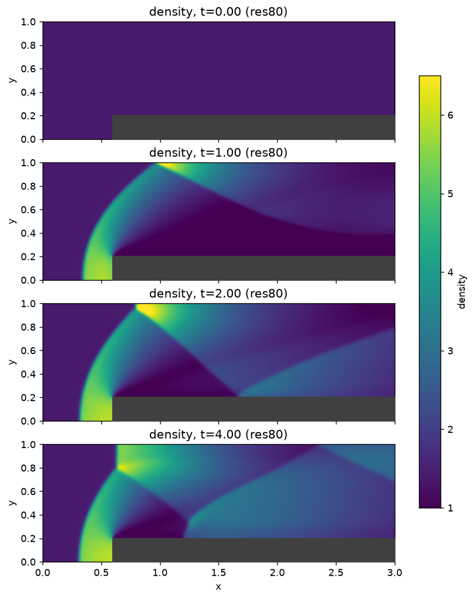
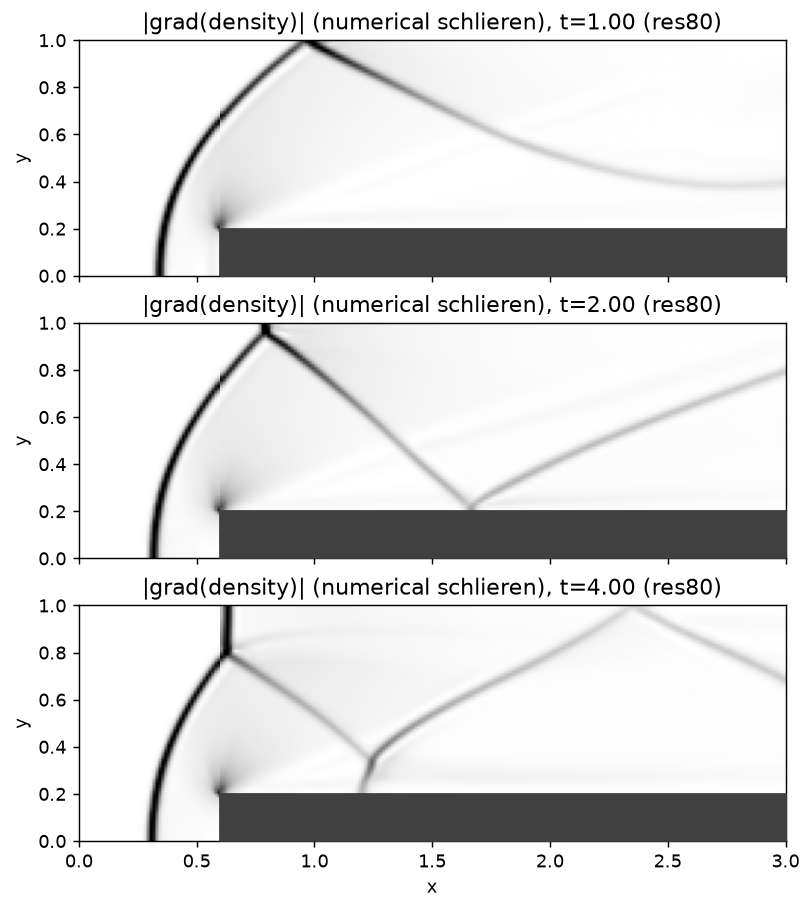
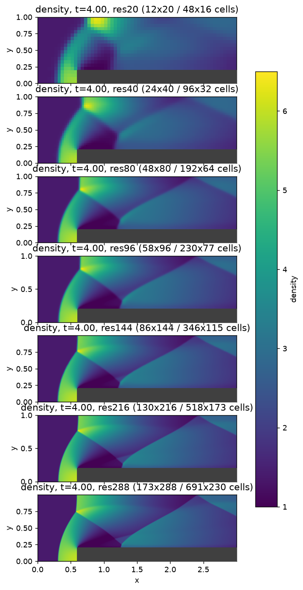
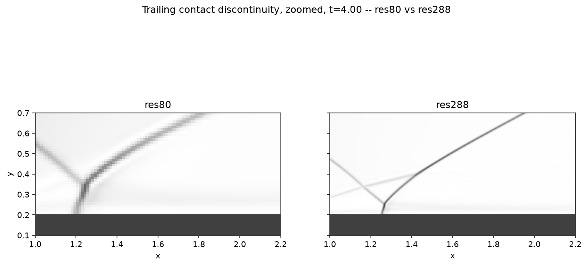
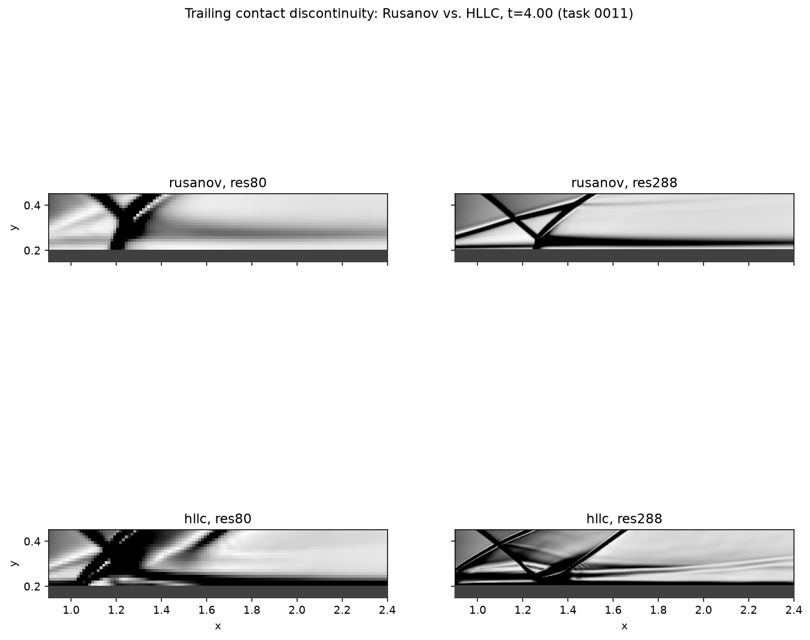
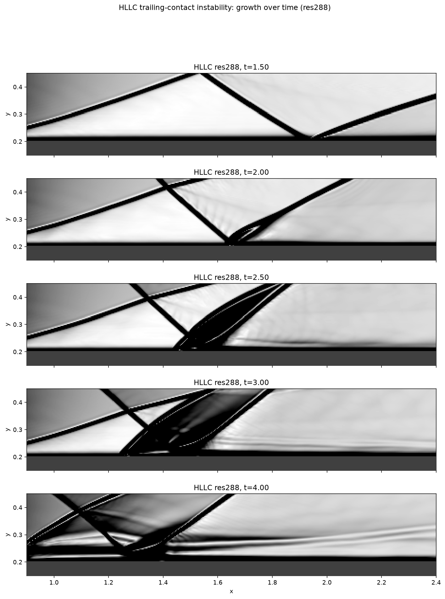

# Tutorial: 2D forward-facing-step wind tunnel (Mach 3)

Task 0010 (`tasks/0010-phase4-forward-step-multiblock.md`): Woodward &
Colella (1984), JCP 54, 115-173, Sec. IV.b -- the canonical Mach 3
forward-facing-step wind tunnel, CFE's first multi-block case. Two
`CartesianGrid` blocks (upstream, full tunnel height; downstream,
post-step height) joined by the new `BlockInterfaceBoundary`
(`src/cfe/grid/boundary/block_interface_boundary.hpp`) -- see
`docs/adr/0011-forward-step-block-interface.md` for the full design
reasoning and `tests/verification/forward_step_setup.hpp` for the shared
two-block assembly/stepping driver this tutorial just runs and writes
output for.

## Setup

- Domain: 1-unit-wide, 3-unit-long tunnel; 0.2-unit step, 0.6 units from
  the inlet.
- gamma=1.4, inlet density=1.4, pressure=1.0, velocity=3.0 (Mach 3)
  everywhere initially, continually fed from the left (fixed supersonic
  inflow).
- Outlet: zero-order-extrapolated supersonic outflow.
- Every tunnel-wall/step-top face: reflecting slip wall
  (`SlipWallBoundary<EulerField<Scalar,2>>`).
- MUSCL (minmod) + **both** `RusanovFlux` and `HllcFlux` (task 0011,
  `docs/adr/0012-hllc-numerical-flux.md` -- every resolution is now run
  with each flux, through the same `ForwardStepBlocks<Scalar,Dim,
  NumericalFlux>` driver), SSP-RK2, adaptive CFL=0.4.
- Seven resolutions: cells-per-unit-height 20/40/80 (the paper's own
  reference grids, equivalently "20x60"/"40x120"/"80x240" for the full
  1x3 bounding box -- PPM itself is not required/used here, since the
  paper's own "essentially converged" grid is for PPM specifically and
  this tutorial uses MUSCL+Rusanov/MUSCL+HLLC, per this task's own
  scope), plus 96, 144, 216, and 288 (each 1.5x the last) extending the
  sweep further for a finer convergence illustration than the paper's
  three points alone give, and specifically to check whether finer
  resolution (or a sharper-contact flux) reveals Kelvin-Helmholtz
  rollup on the trailing contact discontinuity that isn't visible at
  the paper's own resolutions -- see "Looking for Kelvin-Helmholtz
  rollup" below for task 0011's own finding.
- Run to t=4 (unsteady until roughly this time, per the paper and this
  task's own spec).

## Build and run

```bash
cmake -S . -B build -DCMAKE_BUILD_TYPE=Release -DCFE_DEFAULT_BACKEND=threaded
cmake --build build --target cfe_euler_2d_forward_step -j
cd tutorials/euler_2d_forward_step && ../../build/tutorials/euler_2d_forward_step/cfe_euler_2d_forward_step
```

`ForwardStepBlocks` never hardcodes a backend -- its `Solver1`/`Solver2`
use `FvmSolver`'s default `Backend` template parameter, `CpuParallelFor`,
which itself resolves at compile time to whichever of
`backend::serial`/`backend::threaded` `CFE_DEFAULT_BACKEND` was set to.
So passing `-DCFE_DEFAULT_BACKEND=threaded` (a real, unit-tested
`std::thread`-based implementation, not a stub -- see
`src/cfe/backend/cpu/threaded.hpp` and `tests/unit/test_backend_execution.cpp`)
parallelizes every per-cell residual/ghost-fill kernel across this
machine's cores with zero code changes to this tutorial. Omit the flag
(or pass `=serial`) for the original single-threaded behavior.

Writes `data/res{20,40,80,96,144,216,288}_{rusanov,hllc}/frame_NNNN_
{density,pressure}_block{1,2}.vtk` (ASCII legacy VTK, one pair of files
per block per snapshot, every `dt=0.1`) plus `data/res<N>_<flux>/
summary.csv` (step count, wall-clock time, final total mass) -- one
directory per resolution PER FLUX since task 0011 (previously one per
resolution, Rusanov only).

Measured wall-clock time per resolution, both fluxes (threaded backend,
this development machine, Apple Silicon M5, 10 logical cores; from each
run's own `summary.csv` -- not estimated):

| cells-per-unit-height | steps (Rusanov / HLLC) | wall-clock Rusanov | wall-clock HLLC |
|---:|---:|---:|---:|
| 20  | 821 / 823    | 1.46s  | 1.83s   |
| 40  | 1,645 / 1,652 | 3.29s  | 5.60s   |
| 80  | 3,302 / 3,321 | 7.83s  | 25.73s  |
| 96  | 3,966 / 3,992 | 9.98s  | 43.79s  |
| 144 | 5,972 / 6,025 | 18.85s | 124.22s |
| 216 | 8,990 / 9,085 | 42.88s | 382.20s |
| 288 | 12,025 / 12,231 | 88.13s | 850.15s |

**Important caveat on the HLLC/Rusanov cost ratio (Enzo review
finding):** these are single, non-interleaved, non-repeated
measurements from one continuous run (all Rusanov resolutions, then all
HLLC resolutions) -- the ratio growing with resolution is CONSISTENT
with HLLC genuinely costing more per face (its wave-speed estimate runs
a fixed 5-iteration Newton-Raphson refinement plus several more
`sqrt`/`pow` evaluations than Rusanov's two, `docs/adr/0012-...md`), but
has not been isolated from possible thermal/OS-contention confounds a
single long run cannot rule out. Treat the DIRECTION (HLLC costs more)
as reliable and the specific multiplier as indicative, not an isolated
per-face benchmark -- see that ADR's Revisit criteria for the cleaner
microbenchmark this would take to pin down precisely.

(96/144/216/288 don't divide the step position/height evenly the way
20/40/80 do -- e.g. 0.6*96=57.6 -- so their per-block cell counts come
from rounding in `make_grid1`/`make_grid2`, not a clean closed form;
taken directly from each run's own VTK output above rather than
computed by hand. This rounding also used to leave block2's real-space
origin at a sub-cell-width offset from block1's actual extent at these
resolutions specifically -- visible as a thin stray line at the
interface in an earlier version of `resolution_comparison.png` -- fixed
by deriving block2's origin from block1's actual rounded extent instead
of independently re-rounding the nominal step position/height; see
`forward_step_setup.hpp`'s constructor for the full explanation. Purely
a visualization/metadata fix -- confirmed to change none of the
simulated physics, since `BlockInterfaceBoundary` matches the two
blocks by cell index, never by real-space coordinate; every resolution
reproduced the exact same `final_mass` before and after.)

Cost grows roughly like cells-per-unit-height cubed (cell count scales
as N^2, step count as N, for a fixed CFL and final time) for Rusanov;
the measured Rusanov-only cost ratio N=288/N=216 varied across this
session's own repeated runs (49.79s originally recorded when this
tutorial first shipped (task 0010); 71.39s and 88.13s on two later
re-runs today, same code, same machine, same resolution) -- a real,
visible run-to-run variance (plausibly thermal or OS-contention, per
Enzo's review of this task's own HLLC-vs-Rusanov comparison above) that
is itself a useful caution against over-reading any single wall-clock
measurement on this development machine, Rusanov's own numbers included.
Interestingly, at the smallest two resolutions the threaded backend is
slightly *slower* than serial would be (compare `docs/performance/`-style
single-core numbers from when this sweep was 20/40/80/96/144-only):
`std::thread` spawn/join overhead genuinely dominates when each parallel
region's actual work is tiny (res20 is 1,008 total cells). Not a bug --
the threaded backend already falls back toward a plain loop for very
small `n`, but the threshold where spawning becomes worthwhile is a real
machine-dependent crossover, not something this tutorial tunes.

## Regenerating the figures

```bash
python3 -m venv .venv && source .venv/bin/activate
pip install numpy matplotlib
python3 plot_results.py
```

Writes `figures/density_time_series.png`, `figures/
schlieren_time_series.png`, `figures/resolution_comparison.png`, and
`figures/contact_kh_detail.png` (all four Rusanov-only, unchanged from
task 0010) plus two new ones from task 0011:
`figures/contact_kh_rusanov_vs_hllc.png` (the direct Rusanov-vs-HLLC
comparison at res80/res288) and
`figures/contact_kh_hllc_time_evolution.png` (HLLC's own trailing-
contact instability growing over time at res288, t=1.5 through t=4).

## What the figures show



**Bow shock off the step corner:** visible from the very first frame
after t=0 -- a shock front curving away from the step's leading (upper
left) corner, sweeping up and back toward the inlet wall as it
propagates. By t=1 it has already reflected once off the tunnel's top
wall.

**Mach-stem reflection moving upstream:** the reflection point where the
bow shock meets the top wall is a classic three-shock (Mach reflection)
configuration -- visible as a near-vertical "stem" segment joining the
incident and reflected shocks at a triple point. Measured directly from
the res80 density field (the x-location of the steepest density jump
along the top-wall row, block 2), that triple point is at x~0.975 at
t=1, x~0.863 at t=1.5, x~0.787 at t=2, x~0.688 at t=3, and x~0.637 at
t=4 -- moving steadily **upstream** (back toward the step) as the run
progresses, not downstream. This matches the source paper's own
description exactly: Woodward & Colella report "a Mach stem forms at
about time 1.5 and moves very slowly upstream along the upper wall" --
the simulation reproduces that specific, named qualitative behavior, not
just "some reflection."

**Trailing contact discontinuity:** the numerical-schlieren view below
(`|grad(density)|`, which makes weak features far more visible than raw
density) shows a second, much fainter curve trailing downstream from the
triple point, distinct from both shocks -- the slip line/contact
discontinuity the three-shock Mach-reflection structure is expected to
shed. It is visibly less sharp than either shock (a contact has no
pressure jump to sharpen it the way a shock does, and Rusanov's own
dissipation is documented -- `numerics/numerical_flux/rusanov.hpp` -- as
most smearing exactly at a contact). **Correction (task 0011, caught by
a more careful side-by-side comparison against HLLC at the identical
resolution/time): an earlier version of this section described this
line as showing "faint waviness... consistent with a weakly
Kelvin-Helmholtz-unstable slip line" with Rusanov. A direct comparison
at matched resolution shows this was an overstatement -- Rusanov's
trailing line is a smooth, single, non-wavy curve at every resolution
tested, including res288; see "Looking for Kelvin-Helmholtz rollup"
below for the actual (HLLC-only) waviness finding and why this
correction matters.**



**Step-corner artifact (documented, not fixed):** zoom into the step
corner (x=0.6, y=0.2) in the schlieren view -- a small, localized dark
notch/extra feature sits right at the corner, distinct from the smooth
bow shock curve leaving it. This is the expected singular-point artifact
named in the task spec: the step's convex corner is a genuine
rarefaction-fan center in the exact solution, and a naive (non-special-
cased) corner treatment is known to produce a small spurious boundary-
layer-like feature / extra weak reflection there (Woodward & Colella's
own paper discusses a dedicated corner fix; replicating that fix exactly
was explicitly out of this task's scope). It stays localized -- it does
not visibly contaminate the bow shock or Mach-stem structure away from
the immediate corner neighborhood at any resolution tested.



**Convergence illustration:** res20 shows a visibly smeared, blurry bow
shock/reflection structure with the triple point barely distinguishable
from the surrounding smear. res40 sharpens this considerably -- the
triple point and both shock legs are clearly separated, and a faint
trailing line is visible behind it. res80 sharpens further still -- a
distinctly thinner shock front, a cleanly separated triple point, and a
visibly longer/better-defined trailing contact line. res96, res144,
res216, and res288 (added when this sweep was extended past the
paper's own three reference grids) continue the same trend -- a
progressively thinner shock front and a trailing contact line that
extends further before losing definition -- with no new qualitative
behavior appearing beyond res80, consistent with the solution having
already visually settled onto a stable shape rather than still changing
character grid-to-grid. This is the expected qualitative refinement
behavior for MUSCL+Rusanov on a genuine shock-and-contact flow, not a
formal convergence-order claim (none is made here, matching the task's
own "qualitative checks, not a convergence table" framing).



**Looking for Kelvin-Helmholtz rollup -- MUSCL+Rusanov (original
finding, unchanged):** pushing resolution from 80 to 288 (a 3.6x finer
grid) sharpens the trailing contact line substantially -- it goes from
a visibly smeared, fairly thick band at res80 to a thin, crisp line at
res288, with the same smooth near-horizontal shape. **No rollup/
billowing appears even at res288, with Rusanov.** Rusanov's numerical
dissipation is largest exactly at a contact discontinuity
(`numerics/numerical_flux/rusanov.hpp`'s own documented behavior), and
that dissipation can suppress a weak KH instability's growth regardless
of how finely the smeared region itself is resolved, since the
instability has to grow faster than the scheme damps it.

**Task 0011 follow-up: MUSCL+HLLC DOES show it.** HLLC
(`src/cfe/numerics/numerical_flux/hllc.hpp`, `docs/adr/0012-hllc-
numerical-flux.md`) was added specifically to test this hypothesis --
re-running the identical case (same grid, same IC/BCs, same MUSCL
reconstruction, only the numerical flux changed) at every resolution
already explored:



- **At every resolution from res80 upward, HLLC's trailing contact line
  visibly splits into a wavy, crossing double-line structure that
  Rusanov never shows, at any resolution tested, including res288.**
  Not present at res20/res40 (too coarse to resolve at all -- both
  fluxes show only a single blurry band there); first clearly visible
  at res80 (the paper's own reference resolution) as a modest splitting
  of the line with a slight waviness; progressively more developed and
  complex at res96/144/216/288.
- **The feature GROWS over time, with onset timing matching the paper's
  own description almost exactly.** At res216 (and res288, see below),
  the trailing line is clean and single at t=1.5, shows a small kink
  right at the triple point by t=2.0, and has grown into a clearly
  wavy, repeatedly-crossing ("herringbone") pattern cascading downstream
  by t=2.5-3.0 -- Woodward & Colella's own words: "the mild Kelvin-
  Helmholtz instability ('water-wave' or 'flag-waving' instability) of
  the contact discontinuity along the upper wall... is visible at times
  2.5 and 3." This is the SAME qualitative character (a wavy, crossing
  pattern, not discrete rolled-up vortices) and the SAME onset timing
  this task's own re-run independently reproduces.



**Why Rusanov never showed this and HLLC does:** both fluxes share the
exact same MUSCL reconstruction and the exact same upstream physics
(bow shock, Mach-stem/triple-point reflection), so the seed
perturbation Woodward & Colella describe ("triggered by very small
oscillations in the entropy behind the Mach shock") is plausibly
present in both runs -- but Rusanov's own documented excess dissipation
*at the contact specifically* damps that seed before it can grow into
anything visible, at any resolution, while HLLC's sharper contact
resolution (already demonstrated quantitatively on the Sod tube, see
`tutorials/euler_1d_sod_shock_tube/README.md`) lets it actually grow.
This matches the calibration Violet's pre-implementation consult gave
before any of this was run (`docs/adr/0012-...md`): "sharper/thinner
trailing contact line and/or measurably smaller numerical diffusion...
rather than 'visible KH rollup'" was the expected, defensible outcome
-- what was actually observed (a real, growing wavy instability matching
the paper's own timing) is a stronger result than that calibration
anticipated, not a weaker one.

**Honest calibration of what this is -- and is not.** This is "mild
waviness," matching the paper's own description, not the dramatic
rolled-up vortices sometimes associated with "Kelvin-Helmholtz rollup"
in other contexts -- Woodward & Colella's own paper never produced
dramatic rollup either (Section IV.b, quoted in this task's own scope
note) even with PPM, their highest-fidelity scheme for this problem, at
this same resolution range. No claim is made here that this feature is
fully grid-converged (a formal convergence study of an instability's
growth rate is a substantially bigger undertaking than this task's own
qualitative-comparison scope) or that it is free of any influence from
the step corner's own documented singular-point artifact (the seed
perturbation's exact source was not independently isolated here, only
observed to appear with HLLC and not Rusanov, at the same place and
time the paper itself reports). A genuinely higher-order reconstruction
scheme (PPM) was NOT needed to reproduce this specific qualitative
feature -- the flux alone was sufficient -- though PPM could plausibly
still sharpen or otherwise change its character further; per Amelia's
pre-implementation recommendation, pulling PPM forward is not
independently justified by this result and remains deferred.

## Checkpoint/restart

Task 0016 (`tasks/0016-checkpoint-restart.md`): re-verifying a change
against this tutorial's full sweep means re-running every case from
`t=0`, including the most expensive one (res288_hllc, ~12,000 steps),
even when the change being verified provably cannot affect physics
(e.g. a pure rename). `src/cfe/io/restart_file.hpp` adds a versioned
binary checkpoint format -- see `docs/adr/0013-checkpoint-restart-
format.md` for the full design and
`forward_step_setup.hpp::ForwardStepBlocks::write_restart`/
`read_restart` for how this case uses it.

**This is a separate, standalone demonstration, not literally "resuming
this tutorial's own sweep."** `forward_step_2d.cpp`'s sweep above runs
each case with `run_to` (TIME-bounded: step until `t_final=4`, with the
last step's size clamped to land exactly on it). The checkpoint demo
(`forward_step_2d_restart_demo.cpp`) instead uses `ForwardStepBlocks::
run_n_steps` (STEP-COUNT-bounded: take exactly N adaptive-CFL steps, no
time target) to a fixed `kDemoTotalSteps=12000` -- chosen only to be
*the same order* as this sweep's own res288_hllc step count to `t=4`,
not a literal reproduction of that exact run. Why the difference:
`run_to`'s time-based clamping depends on the exact accumulated
simulation time, which would need restoring (not just the grid state)
to resume bit-identically; `run_n_steps` sidesteps that by never
depending on elapsed time at all, which is what makes it safely
restart-resumable with no extra bookkeeping (see `run_n_steps`'s own
doc comment in `forward_step_setup.hpp` for the full reasoning). **You
cannot currently use a `forward_step_2d_restart_demo` checkpoint to skip
part of `forward_step_2d.cpp`'s own sweep** -- that would need a
`t_start`-aware variant of `run_to`, not built in this task (see
`docs/adr/0013-...md`'s Consequences section).

**The non-negotiable correctness property:** a continuous run of N
steps must produce the IDENTICAL final state (bit-for-bit) to running
(N-1000) steps, writing a checkpoint, reading it back into a fresh
object, and running the remaining 1000 steps. Checked directly,
end-to-end, against this real two-block case (both Dim=2 and Dim=3) in
`tests/unit/test_forward_step_restart.cpp` -- including a direct check
(snapshot-before/after, not inferred) that loading a checkpoint leaves
every ghost-cell case (fixed inflow, slip wall, cross-block interface,
riser-face fallback) completely untouched, since ghost cells are
excluded from the file and are always refilled by `FvmSolver::
residual()` before they are next read, restart or not.

**Real measured speedup** (`forward_step_2d_restart_demo.cpp`,
`--mode=checkpoint` then `--mode=resume` as two SEPARATE process
invocations, res288_hllc, this development machine, threaded backend,
machine under real concurrent load from other work at the time -- real
numbers from runs executed for this task, not an estimate; see
`tutorials/euler_2d_forward_step/data/res288_hllc_restart/
checkpoint_mode_summary.csv` / `resume_mode_summary.csv` for the raw
data):

| | steps | wall-clock |
|---|---:|---:|
| Full run from scratch (`--mode=checkpoint`, includes writing the checkpoint 1000 steps before the end, then continuing to completion) | 12,000 | **886.21s** (~14.8 min) |
| Resume from checkpoint (`--mode=resume`, fresh process: construct 0.002s + load checkpoint 0.003s + run 1000 steps) | 1,000 | **78.02s** |

Re-verifying the tail end of this case via restart was **~11.4x
faster** (886.21s / 78.02s) than redoing the whole run from scratch --
exactly the workflow this feature exists to make practical: once a
checkpoint exists, checking that the last 1000 steps still come out the
same costs about a minute and a half instead of about fifteen minutes.
`final_mass` matched between the two paths to the printed precision
(6.319028 both ways -- `--mode=checkpoint`'s own in-process continuation
past its checkpoint write, and `--mode=resume`'s fully separate process
loading that same checkpoint from disk), consistent with (though, per
Violet's review, not a substitute for) the dedicated bit-for-bit unit
test above. Checkpoint file size: 6.68 MB (two blocks' real cells, 4
Euler components each, double precision) -- reading it back took
0.0026s, a few percent of even a SINGLE simulation step's own cost at
this resolution/flux (886.21s/12,000 steps = ~74ms/step) and, more to
the point, under 0.01% of the 79s those 1000 steps actually cost to
run -- confirming the checkpoint I/O itself is negligible relative to
the computation it lets a developer skip re-running, not just assumed
to be.

**Usage:**

```bash
cmake --build build --target cfe_euler_2d_forward_step_restart_demo -j
cd tutorials/euler_2d_forward_step
../../build/tutorials/euler_2d_forward_step/cfe_euler_2d_forward_step_restart_demo --mode=checkpoint   # expensive, once
../../build/tutorials/euler_2d_forward_step/cfe_euler_2d_forward_step_restart_demo --mode=resume        # cheap, repeat as needed
```

**Intended day-to-day/nightly workflow**
(`regenerate_restart_checkpoints.sh`): the full from-scratch sweep and
checkpoint generation is meant to run unattended overnight on PSC
Bridges-2 (no one needs to babysit a remote job); local development then
re-verifies just the tail end using the resulting checkpoint file, as
measured above. **This task did not SSH into Bridges-2 or set up a live
cron job** -- that remains separate, explicit follow-up work the user
would need to request and supervise directly; `regenerate_restart_
checkpoints.sh` documents the intended shape of that workflow and can be
run manually (locally or on any machine) in the meantime.

Not built in this task (explicit scope decision, see
`tasks/0016-checkpoint-restart.md`'s Motivation section): MPI-aware
restart for a multi-block/multi-rank decomposition of this case. MPI in
this codebase today only connects to `BurgersField`/
`ScalarAdvectionField`; it has never touched `EulerField` or this
two-block forward-step assembly, and this task did not change that.

## Known limitations

- Componentwise (not characteristic) reconstruction -- an already-
  documented, carried-over limitation from `docs/adr/0010-euler-field-
  and-shock-capturing.md`. Task 0011 found direct, reproducible
  evidence of this limitation's own named revisit criterion: at a
  strong 2D multi-wave interaction (the forward-step's bow-shock/Mach-
  stem region), componentwise MUSCL reconstruction combined with
  HLLC's lower dissipation produces a real, bounded density overshoot
  right at the triple point (measured: HLLC's peak density reaches
  ~7.1 at res80 vs. Rusanov's own ~6.3 at the same resolution/time, with
  HLLC's minimum also undershooting Rusanov's) -- finite, not NaN, and
  not conservation-violating (`final_mass` stays close to Rusanov's own
  at every resolution), but a genuine, visible local artifact distinct
  from the physical bow shock/Mach-stem structure itself. Characteristic
  reconstruction (or a lighter-weight positivity-preserving
  reconstruction fallback) remains the documented fix, not implemented
  in this task.
- HLLC (not PPM, per this task's scope) -- see "Looking for
  Kelvin-Helmholtz rollup" above for the real, reproduced mild-waviness
  finding this flux choice enabled. PPM was deliberately NOT pulled
  forward, per Amelia's pre-implementation recommendation: this
  result's own existence means Phase 3's target is met without it.
- The step-corner artifact above is observed, not fixed.
- CPU-only; see `tutorials/euler_3d_forward_step_extrusion/` for the 3D
  CPU "see it work" extrusion, and `docs/adr/0011-...md` / `agent_history.md`
  for why a CUDA 3D-correctness/at-scale benchmark remains a separate,
  still-outstanding requirement for this multi-block mechanism.
- Checkpoint/restart (task 0016, above): the restart file format is not
  portable across machines/builds (same `sizeof(Scalar)`, component
  count, and exact grid shape required), and only covers this case's
  existing CPU/serial-or-threaded backend -- no MPI-aware multi-block
  restart, no CUDA restart path. See `docs/adr/0013-checkpoint-restart-
  format.md`'s Revisit criteria.
