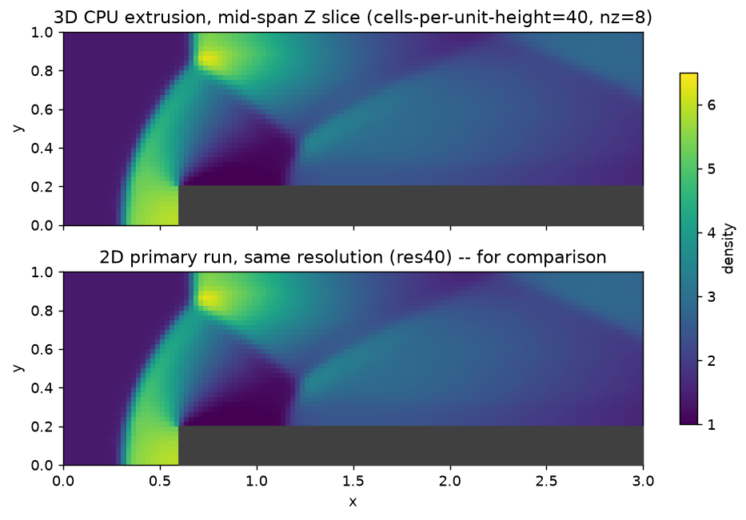

# Tutorial: 3D CPU extrusion of the forward-facing-step case

Task 0010's "see it work" 3D deliverable: a simple spanwise extrusion of
`tutorials/euler_2d_forward_step/`'s geometry (periodic on the new Z
faces), run on this machine's CPU backend (Apple Silicon -- no CUDA
available here). Uses the same `ForwardStepBlocks<Scalar,3>` assembly
(`tests/verification/forward_step_setup.hpp`) as the 2D tutorial, just
instantiated at `Dim=3` with a thin spanwise depth.

**This is explicitly NOT a substitute for this project's standing,
separate requirement that every PR adding a Field/scheme include a 3D
CUDA correctness test and an at-scale benchmark on real CUDA hardware**
(see `docs/performance/0007-phase3-euler-cuda-results.md` for how task
0009 closed that gap for single-block `EulerField` on PSC Bridges-2).
That CUDA work remains outstanding for this multi-block mechanism
specifically and is called out again in `docs/adr/0011-forward-step-
block-interface.md` and `agent_history.md`'s completion entry for this
task -- not silently dropped.

## Setup

Same physical case as the 2D tutorial, at cells-per-unit-height=40
(comparable to the paper's own "40x120" convergence-illustration grid --
run at one resolution rather than all three, since a full 3-resolution
3D sweep adds compute cost for no additional evidence beyond what the 2D
sweep already demonstrates), extruded 8 cells deep (`span_z=0.2`,
arbitrary -- not a physically meaningful depth) with `PeriodicBoundary`
on the new Z faces.

## Build and run

```bash
cmake -S . -B build -DCMAKE_BUILD_TYPE=Release
cmake --build build --target cfe_euler_3d_forward_step_extrusion -j
cd tutorials/euler_3d_forward_step_extrusion && \
  ../../build/tutorials/euler_3d_forward_step_extrusion/cfe_euler_3d_forward_step_extrusion
```

Took ~11.5s wall-clock on this development machine (single core),
repeatable across three fresh runs (11.56s/11.49s/11.49s) -- see `data/
summary.csv`. The 2D res40 run (same cells-per-unit-height, same
resolution/time stepping, just `nz_cells=1`) is likewise repeatable at
~0.85-0.88s (`../euler_2d_forward_step/data/res40/summary.csv`), so the
real measured ratio is **~13-14x**, not simply the 8x a naive "8
Z-cells, same per-column cost" estimate would predict -- a first attempt
at this comparison used a single non-repeated 2D measurement that turned
out to be a one-off fast outlier, not the true steady-state cost; the
numbers above are from repeated runs, not a single sample. The extra
cost beyond 8x is plausible (not a red flag): per-step work that does
not scale with `nz_cells` (ghost-cell bookkeeping, the two blocks'
boundary-condition dispatch, VTK snapshot writing) is a larger fraction
of each column's total cost once each column itself is cheap, so going
from 1 to 8 Z-cells should cost somewhat MORE than a clean 8x, not
exactly 8x. Writes `data/frame_NNNN_density_block{1,2}.vtk` every
`dt=0.25` plus `data/summary.csv`.

## Confirms: the extrusion stays exactly 2D

Because the initial condition and every boundary condition (including
the new cross-block `BlockInterfaceBoundary`, Z-invariant by
construction since neither block's own Z extent affects its X-direction
ghost fill) are uniform in Z, and `PeriodicBoundary` introduces no Z
variation from a uniform state, Z-momentum should stay exactly zero
throughout and every Z slice should evolve identically to the 2D
solve -- the same argument `tests/unit/test_euler_3d_sanity.cpp` already
makes and verifies for the Sod tube. Two independent checks confirm this
held for the full run, not just at t=0:

- The solver's own printed diagnostic: `max|mom_z| = 0.000e+00` at
  t=4 (not just "small" -- exactly zero, every real cell of both
  blocks).
- `plot_results.py` (below) compares a mid-span Z slice of this 3D run's
  final-time density field directly against the 2D tutorial's own res40
  run: **max absolute difference = 0.000e+00** -- bit-identical, not
  merely visually similar.

```bash
python3 -m venv .venv && source .venv/bin/activate
pip install numpy matplotlib
python3 plot_results.py
```



(Requires `tutorials/euler_2d_forward_step/`'s own `res40` run to have
been generated already -- run that tutorial first if starting from
scratch.)

## Known limitations

- CPU-only (Apple Silicon, no CUDA on this machine) -- the standing
  separate CUDA 3D-correctness/at-scale-benchmark requirement remains
  outstanding for this multi-block mechanism; see this file's header
  comment and `agent_history.md`'s completion entry for task 0010.
- One resolution, one arbitrary spanwise depth -- a "see it work"
  demonstration, not a 3D convergence or scaling study.
- Because the extrusion is exactly Z-invariant by construction, this run
  does not exercise any genuinely 3D physics (a case with actual
  spanwise variation, e.g. a 3D obstacle or a non-uniform inlet, would be
  a different, future demonstration).
